# 🧊 Project-Minus5: Head & Shoulders Buzlu Mentol Ferahlığı — 360° Talkability & Marka İnşa Mimarisi

-00E5FF?style=for-the-badge)

> **Proje Amacı:** Head & Shoulders Buzlu Mentol Ferahlığı şampuanını, 18–24 yaş arası gençler arasında organik olarak konuşulan (*talkable*), denemeye teşvik eden (*trial-driving*) ve markaya yeni kullanıcılar kazandıran (*user acquisition*) kültürel bir fenomene dönüştürmek.  
> **Temel Çerçeve:** P&G **WHO / WHAT / HOW / SUCCESS** Brand Building Framework (100 Puanlık Değerlendirme Mimarisi).

---

## 📂 Proje Dizin Yapısı ve Hızlı Erişim

Bu çalışma, hem ana strateji özetini hem de her fazın derinlemesine mühendislik ve pazarlama kırılımlarını içerecek şekilde modüler olarak yapılandırılmıştır:

| Modül / Dosya | İçerik Özeti | P&G Puan Ağırlığı |
| :--- | :--- | :---: |
| 📄 **[`README.md`](./README.md)** | Yönetici Özeti ve uçtan uca **WHO / WHAT / HOW / SUCCESS** ana strateji dokümanı | **100 Puan (Tamamı)** |
| 🎯 **[`docs/01-WHO-Consumer-Personas-and-Insights.md`](./docs/01-WHO-Consumer-Personas-and-Insights.md)** | 3 Çekirdek Z Kuşağı Personası, Gerilim-İçgörü Matematiği ve Reason-to-Believe (RTB) analizi | **30 Puan** |
| 💡 **[`docs/02-WHAT-Creative-Strategy-and-Copywriting.md`](./docs/02-WHAT-Creative-Strategy-and-Copywriting.md)** | Büyük Yaratıcı Fikir, Slogan Mimarisi, TikTok/Reels Senaryoları ve Talkability Psikolojisi | **45 Puan** |
| 🚀 **[`docs/03-HOW-360-Execution-and-Phased-Rollout.md`](./docs/03-HOW-360-Execution-and-Phased-Rollout.md)** | Termal AR Filtresi, *Emergency Cool-Down Pod* Teknik Kurulumu, Perakende POSM ve 12 Haftalık Plan | **20 Puan** |
| 📊 **[`docs/04-SUCCESS-KPI-Framework-and-Analytics.md`](./docs/04-SUCCESS-KPI-Framework-and-Analytics.md)** | Kuzey Yıldızı KPI Matrisi, QR/UTM Dönüşüm Hunisi, A/B Test Kurgusu ve DO's/DON'Ts Denetimi | **5 Puan** |
| 🛠️ **[`docs/05-Emergency-CoolDown-Pod-IoT-Architecture.md`](./docs/05-Emergency-CoolDown-Pod-IoT-Architecture.md)** | *Emergency Cool-Down Pod* 4D Duyusal Donanım, Akıllı Numune Otomatı, KVKK ve IoT Telemetri Mimarisi | **Mühendislik Ek** |
| 🎤 **[`docs/06-Pitch-Deck-and-Jury-QA-Playbook.md`](./docs/06-Pitch-Deck-and-Jury-QA-Playbook.md)** | 5 Dakikalık Pitch Sunum Akışı, Optimal Bütçe Dağılımı ve Jüri Soru-Cevap (Q&A) Savunma Matrisi | **Sunum Rehberi** |
| 🖥️ **[`index.html`](./index.html)** | **İnteraktif Web Simülatörü:** Canlı *Termal Kamera AR Filtresi*, *Pod QR Telemetri* ve *KPI & ROI Hesaplayıcı* | **Canlı Prototip** |

---

## 🧭 Kampanya Mimarisinin Tek Bakışta Özeti (Executive Blueprint)

```mermaid
flowchart LR
    subgraph WHO["1. WHO (30p)"]
        W1["18-24 Yaş Aktif Z Kuşağı"]
        W2["İçgörü: Ders, CTF ve Spor Sonrası\n'Hararet' ve 'Sistem Sıfırlama' İhtiyacı"]
    end

    subgraph WHAT["2. WHAT (45p)"]
        T1["Konumlandırma:\n'Acil Durum Soğutma Butonu'"]
        T2["Slogan:\n'Harareti Kes, -5°C Hissine Geç!'"]
    end

    subgraph HOW["3. HOW (20p)"]
        H1["Faz 1: Termal Kamera AR Filtresi"]
        H2["Faz 2: Kampüs & Gym Cool-Down Kabinleri"]
        H3["Faz 3: Soğutucu Dolap POSM & Hızlı Ticaret"]
    end

    subgraph SUCCESS["4. SUCCESS (5p)"]
        S1["#HararetiKes Organik UGC"]
        S2["QR Kodlu Numune Dönüşümü"]
        S3["Perakende Satış Hacmi Artışı"]
    end

    WHO --> WHAT --> HOW --> SUCCESS
```

---

## 1. WHO — Tüketici ve İçgörü (30 Puan)

### 🎯 Hedef Kitle (Target Audience)
**18–24 yaş arası**, sürekli hareket halinde olan, hem zihinsel hem de fiziksel olarak sınırlarını zorlayan **Z kuşağı üniversite öğrencileri, genç yazılımcılar/mühendisler ve aktif spor yapan gençler**.

### 🔍 Tüketici İçgörüsü (Consumer Insight)
Gençlerin hayatı **"hararetli"** (yüksek tempo, stres, ısı ve ter dolu) anlarla şekilleniyor:
* **Zihinsel Hararet:** Bazen **Cumhurbaşkanlığı Millet Kütüphanesi**'nde saatler süren vize/final sabahlamalarında veya kodlama maratonlarında zihinleri alev alıyor; bazen de saatlerce süren siber güvenlik bayrağı yakalama (**CTF**) ve Hackathon yarışmalarında bilgisayar sistemleri gibi kendi beyinleri de ısınıyor.
* **Fiziksel Hararet:** Bazen de spor salonunda ağır *squat* veya *bench press* antrenmanları sonrasında ya da kampüs koşturmacasında fiziksel olarak bunalıyorlar.

Bu yoğun anlarda **ter, saç derisinde rahatsızlık/kaşıntı ve potansiyel kepek problemi** birleştiğinde, gençler o "yanma ve bunalma" hissinden kurtulup anında bir **"sistem sıfırlamasına (reset)"** ihtiyaç duyuyorlar.

### Segmente Edilmiş Tüketici Personaları

| Persona | "Hararet" Anı (Tetikleyici) | Yaşanan Gerilim (Pain Point) | Doğal Argo / Söylem | H&S Buzlu Mentol Çözümü |
| :--- | :--- | :--- | :--- | :--- |
| **👨‍💻 Zihinsel Maratoncu** *(Üniversiteli / CTF & Hackathon Yarışmacısı)* | Gece 03:00 kütüphane sabahlaması, vize/final haftası, uzun kodlama seansları | Kafa derisinde ısınma, yağlanma, odak kaybı ve "beyin yanması" hissi | *"Kafa yandı, sistem error verdi, reset lazım."* | Zihni açan **"-5°C Ferahlık Hissi"** ile soğuk başlatma (*Cold Boot*). |
| **🏋️ Fiziksel Sınır Zorlayıcı** *(Gym & Kampüs Sporcusu)* | Ağır squat/bench press antrenmanı veya halı saha maçı çıkışı | Yoğun terleme, saç derisinde yapışkanlık, kaşıntı ve kepek endişesi | *"Hararet tavan yaptı, buhar oldum."* | Antrenman sonrası yangıyı dindiren **"-5°C Acil Soğutma"** ve kepek koruması. |
| **🎧 Sosyal Hiperaktif** *(Kampüs & Festival Gezgini)* | Gün boyu ders, kulüp etkinliği ve toplu taşıma sonrası akşam buluşması | Sönük/ağırlaşmış saçlar, günün yorgunluğu, özgüven düşüşü | *"Hararet yapma, bi' kafayı soğutalım."* | Sosyal ortama çıkmadan önce anında tazelik ve **%100'e kadar kepeksiz özgüven**. |

### 🧊 Neden Head & Shoulders? (Reason to Believe)
Çünkü **H&S Buzlu Mentol Ferahlığı**, kepeğe karşı kanıtlanmış etkili korumasının yanında, mentol kristalleri içeren formülüyle onlara suyla temas ettiği anda ihtiyaç duydukları **"-5°C ferahlık hissini"** sunuyor.  
*(📌 **Önemli Not:** Bu gerçek bir sıcaklık düşüşü değil, ürünün saç derisinde yarattığı benzersiz bir duyusal ferahlık hissidir.)*

---

## 2. WHAT — Marka Önermesi ve Büyük Yaratıcı Fikir (45 Puan)

Snickers'ın *"Açken sen sen değilsin"* veya Popeyes'ın *"Terbiyesiz tavuk"* kampanyalarındaki o akılda kalıcı **zıtlık (gerilim) ve çözüm matematiğini** kuruyoruz:

* **Gerilim (Zıtlık):** Hararet (Kırmızı / Aşırı Isınma / Bunalma / Kepek Stresi)
* **Çözüm (Dönüşüm):** -5°C Ferahlık Hissi (Buz Mavisi / Anında Reset / Ferah Saç Derisi)

### 💡 Büyük Yaratıcı Fikir (Big Creative Idea)
Şampuanı sadece rutin bir "banyo temizlik ürünü" olmaktan çıkarıp, gençlerin hararet yaptığı anlarda basacakları bir **"Soğutma Butonu / Emergency Cool-Down"** olarak konumlandırıyoruz. Fikir, tüketicinin en bunaldığı (hararet yaptığı) anda **"-5°C ferahlık hissi"** ile fiziksel ve zihinsel olarak yenilenmesini merkeze alıyor.

### 📢 Kampanya Sloganı (Turkish Campaign Slogan)

> # ***"Harareti Kes, -5°C Hissine Geç!"***

### 🗣️ Neden Konuşulur? (Talkability Matematiği)
1. **Doğal Argoyu Sahiplenme (Linguistic Hijacking):** Gençler gündelik hayatta bunaldıklarında, sinirlendiklerinde veya çok yorulduklarında birbirlerine zaten *"hararet yapma"*, *"kafanı soğut"*, *"beynim yandı"* derler. Slogan, bu doğal argoyu sahiplenerek günlük sohbetlerin (konuşulabilirliğin) organik bir parçası haline gelir.
2. **Görsel Kontrast:** Termal kamera kırmızısından buz mavisine geçiş, TikTok ve Instagram Reels akışında ilk saniyede dikkat çeken ikonik bir görsel imza yaratır.
3. **Paylaşılabilir Mizah:** Gençler final haftasında veya spor sonrasında kendi "tükenmişlik/hararet" anlarını mizahi bir dille paylaşmayı severler; kampanya onlara bu paylaşım için hazır bir şablon sunar.

---

## 3. HOW — Konuşulabilir 360-Derece Plan (20 Puan)

Bu aşamayı, tüketicinin markayla temas ettiği tüm noktaları (*touchpoints*) optimize eden **üç fazlı entegre bir sistem** olarak tasarlıyoruz. Fikirlerin hiçbiri birbirinden kopuk (*disconnected*) değil; hepsi **"harareti kesme ve -5°C hissine geçme"** ana fikrine hizmet ediyor.

### 📱 Faz 1: Dijital Etkileşim ve AR (Konuşmayı Başlatma)
* **Aksiyon:** TikTok ve Instagram için özel bir **"Termal Kamera" Artırılmış Gerçeklik (AR)** filtresi ve `#HararetiKes` akımı.
* **İşleyiş:**
  1. Kullanıcı filtreyi açtığında kafası **kırmızı/turuncu (hararetli termal kamera görünümünde)** görünür ve ekranda `[HARARET: %99 🔥]` uyarısı yer alır.
  2. Kullanıcı kafasını salladığında (*head shake*) veya ekrana dokunduğunda ekran buzlanır, saçları buz kristalleriyle kaplanmış gibi görünür ve filtre **`[-5°C HİSSİ AKTİF ❄️]`** yazısıyla ferah buz mavisi bir görünüme geçer.
* **Talkability & Topluluk Entegrasyonu:**
  * Gençler final haftalarında, Hackathon/CTF yarışmalarında veya zorlu antrenmanlar sonrasında bu filtreyi kullanarak *"Benim hararet tavan yaptı, -5°C hissine geçiyorum"* diyerek kendi durumlarını eğlenceli bir şekilde paylaşırlar.
  * Kampüs teknoloji kulüpleri, espor turnuvaları ve spor topluluklarıyla eş zamanlı tohumlama (*seeding*) yapılır.

### 🧊 Faz 2: Gerilla Pazarlama ve Kampüs Aktivasyonları (Fiziksel Deneyim)
* **Aksiyon:** **"Acil Durum Ferahlama Kabinleri" (Emergency Cool-Down Pods)**.
* **İşleyiş:**
  * Üniversite kampüslerine (örneğin **ODTÜ**'nün merkezi noktalarına, İTÜ'ye, büyük kütüphane çıkışlarına) ve yoğun spor salonlarının çıkışlarına, dev bir şampuan şişesi / kriyo-kabin formunda, içi soğuk hava ve ferah mentol kokusu üfleyen interaktif kabinler yerleştirilir.
  * Kabin dışındaki termal ekran yaklaşan öğrenciyi *"Hararet Tespit Edildi!"* diyerek içeri davet eder. İçerideki **"Harareti Kes"** butonuna basıldığında 10 saniyelik soğuk hava, mavi LED ışık ve rüzgar efektiyle anında ferahlama deneyimi yaşatılır.
* **Talkability & Deneme (Trial):**
  * Gençler kabine girip ferahlar, kabin içi kamerayla ağır çekim (*slow-motion*) videolarını alır ve çıkışta **üzerinde dinamik QR kod bulunan seyahat boyu (90 ml) H&S Buzlu Mentol numunesini (sample)** teslim alırlar.
  * Bu sıra dışı fiziksel deneyim, çevrelerine anlatmaları ve sosyal medyada paylaşmaları için güçlü bir **"anlatma sebebi (reason to share)"** üretir.

### 🛒 Faz 3: Perakende (Retail) ve Satın Almaya Yönlendirme (Conversion)
* **Aksiyon:** Marketlerdeki kişisel bakım reyonlarında **"Soğutucu Dolap (Cooler Stand)"** görünümlü özel POSM stantlar ve Hızlı Ticaret (Quick-Commerce) entegrasyonu.
* **İşleyiş:**
  * Dijitalde ve kampüste yaratılan sohbeti (*talkability*) ürünü satın almaya (*purchase*) dönüştürmek için, H&S Buzlu Mentol Ferahlığı reyonlarda standart şampuan raflarında değil; **buzdolabı/içecek soğutucusu hissiyatı veren**, buğulu cam detaylı ve buz mavisi LED aydınlatmalı özel stantlarda sergilenir.
  * Ayrıca Getir / Trendyol Go gibi hızlı ticaret uygulamalarında gece ders çalışanların veya spor yapanların sipariş ettiği soğuk içecek/enerji içeceği sepetlerine *"Kafanı da Soğut: H&S Buzlu Mentol"* kasa önü çapraz satış teklifi eklenir.

---

## 4. SUCCESS — Başarı Ölçütleri (KPIs) (5 Puan)

Sistemin başarısını rastgele tahminlerle değil, uçtan uca izlenebilir **mühendislik ve pazarlama metrikleriyle** takip ediyoruz:

| KPI Kategorisi | Ölçüt (Metrik) | Ölçüm Yöntemi | 12 Haftalık Hedef |
| :--- | :--- | :--- | :--- |
| **1. Konuşulabilirlik (Talkability KPIs)** | **AR Filtre & UGC Paylaşım Sayısı** | TikTok ve Instagram'da Termal Kamera AR filtresinin kullanım ve organik içerik (UGC) üretimi | **75.000+ Organik Paylaşım** |
| **1. Konuşulabilirlik (Talkability KPIs)** | **Kampanya Etiketi Erişim & Etkileşimi** | `#HararetiKes` etiketinin toplam erişimi (Reach) ve etkileşim oranı (Engagement Rate) | **5M+ Erişim / >%6.5 ER** |
| **2. Deneme ve Satın Alma (Trial & Purchase KPIs)** | **Fiziksel Kabin Deneyimi & Numune** | *Emergency Cool-Down Pod* ziyaretçi sayısı ve dağıtılan QR kodlu numune adedi | **50.000+ Numune Dağıtımı** |
| **2. Deneme ve Satın Alma (Trial & Purchase KPIs)** | **QR Kod Dönüşüm Oranı (Conversion)** | Dağıtılan numuneler üzerindeki QR kodların taranma (%28+) ve ilk satın alma kuponuna dönüşüm oranı | **>%12 Kuponla İlk Satın Alma** |
| **2. Deneme ve Satın Alma (Trial & Purchase KPIs)** | **Perakende Satış Hacmi Artışı (Uplift)** | "Soğutucu Dolap" POSM standı bulunan perakende noktalarında gerçekleşen SKU bazlı satış hacmi artışı | **+%22 Satış Hacmi Artışı** |

---

## ✅ P&G DO's & DON'Ts Uyumluluk Kontrol Listesi (Audit Checklist)

* **[x] Tüketici zorluğu üzerinde hemfikir olundu mu?**  
  Evet — Gençlerin yoğun çalışma (kütüphane/CTF/sınav) ve spor anlarında yaşadıkları zihinsel/fiziksel **hararet, ter ve saç derisi bunalması** net bir içgörü olarak tanımlandı.
* **[x] Tek bir net slogan var mı?**  
  Evet — ***"Harareti Kes, -5°C Hissine Geç!"*** tüm dijital, fiziksel ve perakende mecralarda tek çatı slogan olarak konumlandırıldı.
* **[x] Aktivasyonlar ana fikirle birleşik mi?**  
  Evet — Dijitaldeki *Termal AR Filtresi*, kampüsteki *Ferahlama Kabini* ve marketteki *Soğutucu Dolap Standı* birbirinden kopuk değil; hepsi "Harareti Kes -> -5°C Hissine Geç" deneyiminin birbirini tamamlayan halkalarıdır.
* **[x] -5°C bir "his" olarak mı anlatıldı? (No Invented Product Claims)**  
  Evet — Gerçek/tıbbi bir sıcaklık düşüşü iddiası kesinlikle yapılmadı; tüm iletişimde ürünün yarattığı **"-5°C ferahlık hissi"** (duyusal etki) vurgulandı.

---

## 🖥️ Canlı Simülasyonu Çalıştırma

Proje kök dizininde yer alan **[`index.html`](./index.html)** dosyasını herhangi bir modern web tarayıcısında açarak:
1. **Termal Kamera AR Filtresi Simülatörü** ile *Kütüphane/CTF*, *Gym/Squat* ve *Kampüs* senaryolarında **"Harareti Kes (-5°C Hissine Geç)"** geçişini interaktif olarak test edebilirsiniz.
2. **Canlı KPI & Dönüşüm Simülatörü** üzerinden erişim, numune sayısı ve QR tarama oranlarını değiştirerek beklenen UGC ve perakende satış artışını dinamik olarak hesaplayabilirsiniz.
