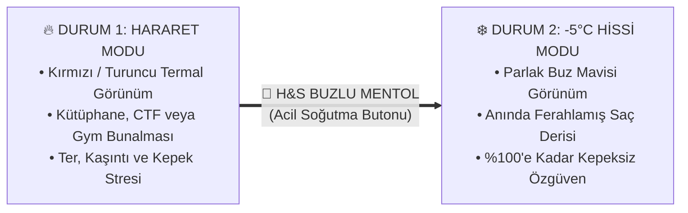
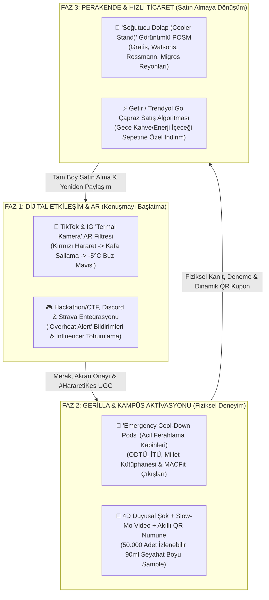
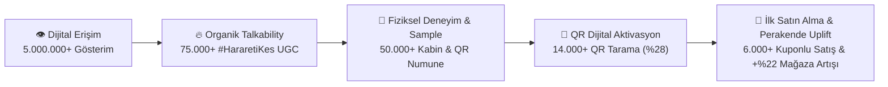

# 🧊 Project-Minus5: Head & Shoulders Buzlu Mentol Ferahlığı — 360° Talkability, Deneyim ve Marka İnşa Mimarisi

-00E5FF?style=for-the-badge)

> **Proje Adı:** `Project-Minus5` (Head & Shoulders Buzlu Mentol Ferahlığı Kampanyası)  
> **Proje Amacı:** Head & Shoulders Buzlu Mentol Ferahlığı şampuanını, 18–24 yaş arası gençler arasında organik olarak konuşulan (*talkable*), denemeye teşvik eden (*trial-driving*) ve markaya yeni kullanıcılar kazandıran (*user acquisition / new-to-brand*) kültürel bir fenomene dönüştürmek.  
> **Temel Çerçeve:** P&G **WHO (30 Puan) / WHAT (45 Puan) / HOW (20 Puan) / SUCCESS (5 Puan)** Brand Building Framework.  
> **Çatı Slogan:** ***"Harareti Kes, -5°C Hissine Geç!"***

---

## 📂 Proje Dizin Yapısı ve Dokümantasyon Haritası

| Modül / Dosya | İçerik Kapsamı | P&G Rubrik Karşılığı |
| :--- | :--- | :---: |
| 📄 **[`README.md`](./README.md)** | Kapsamlı Master Strateji Dokümanı (Uçtan uca WHO / WHAT / HOW / SUCCESS, Senaryolar, Bütçe, Risk ve Q&A) | **100 Puan (Tamamı)** |
| 🖨️ **[`PROJE-CIKTI-RAPORU.md`](./PROJE-CIKTI-RAPORU.md)** | Yarışma Teslimi, Sunum ve Jüri Özeti İçin Doğrudan Kopyalanabilir / Yazdırılabilir Tam Metin Çıktısı | **Teslim Çıktısı** |
| 📑 **[`rapor-ciktisi.html`](./rapor-ciktisi.html)** | Tarayıcıdan `Ctrl + P` ile Doğrudan **A4 PDF** Olarak Kaydedilebilen Resmi Rapor Çıktısı Tasarımı | **A4 PDF Çıktısı** |
| 🎤 **[`sunum-deck.html`](./sunum-deck.html)** | **5 Dakikalık İnteraktif Jüri Sunumu (10 Slayt):** Klavye ile kontrol edilen, canlı sayaçlı ve konuşmacı notlu Pitch Deck | **Canlı Sunum Deck** |
| 🖥️ **[`index.html`](./index.html)** | **360° Komuta Merkezi:** *Termal AR Filtresi*, *4D Pod QR Üretici*, *Soğutucu Dolap POSM*, *Hızlı Ticaret* ve *KPI Simülatörü* | **Canlı Prototip** |
| 📷 **[`ar-deneyim.html`](./ar-deneyim.html)** | **Canlı WebRTC Kamera & Termal AR Filtre Stüdyosu:** Gerçek zamanlı Termal LUT $\rightarrow$ -5°C Buz Mavisi dönüşümü ve 9:16 Story PNG indirici | **AR Stüdyo** |
| 🗺️ **[`kampus-harita.html`](./kampus-harita.html)** | **Türkiye Kampüs & Gym IoT Telemetri Haritası:** ODTÜ, İTÜ, Millet Kütüphanesi ve MACFit kabinlerinin canlı stok ve QR dönüşüm radarı | **IoT Saha Haritası** |
| 🎯 **[`docs/01-WHO-Consumer-Personas-and-Insights.md`](./docs/01-WHO-Consumer-Personas-and-Insights.md)** | 3 Çekirdek Z Kuşağı Personası, Gerilim-İçgörü Matematiği ve Reason-to-Believe (RTB) Analizi | **30 Puan (WHO)** |
| 💡 **[`docs/02-WHAT-Creative-Strategy-and-Copywriting.md`](./docs/02-WHAT-Creative-Strategy-and-Copywriting.md)** | Büyük Yaratıcı Fikir, Slogan Mimarisi, TikTok/Reels Senaryoları ve Talkability Psikolojisi | **45 Puan (WHAT)** |
| 🚀 **[`docs/03-HOW-360-Execution-and-Phased-Rollout.md`](./docs/03-HOW-360-Execution-and-Phased-Rollout.md)** | Termal AR Filtresi, *Emergency Cool-Down Pod* Kurulumu, Perakende POSM ve 12 Haftalık Yayılım Planı | **20 Puan (HOW)** |
| 📊 **[`docs/04-SUCCESS-KPI-Framework-and-Analytics.md`](./docs/04-SUCCESS-KPI-Framework-and-Analytics.md)** | Kuzey Yıldızı KPI Matrisi, QR/UTM Dönüşüm Hunisi, A/B Test Kurgusu ve DO's/DON'Ts Denetimi | **5 Puan (SUCCESS)** |
| 🛠️ **[`docs/05-Emergency-CoolDown-Pod-IoT-Architecture.md`](./docs/05-Emergency-CoolDown-Pod-IoT-Architecture.md)** | Ferahlama Kabinlerinin 4 Boyutlu Duyusal Donanımı, Adil Numune Otomatı ve KVKK Uyumluluk Mimarisi | **Mühendislik Ek** |
| 🎤 **[`docs/06-Pitch-Deck-and-Jury-QA-Playbook.md`](./docs/06-Pitch-Deck-and-Jury-QA-Playbook.md)** | 5 Dakikalık Sunum (Pitch) Akışı, Optimal Bütçe Dağılımı ve Jüri Soru-Cevap (Q&A) Savunma Rehberi | **Sunum Rehberi** |
| 🛒 **[`docs/07-Retail-POSM-and-Quick-Commerce-Playbook.md`](./docs/07-Retail-POSM-and-Quick-Commerce-Playbook.md)** | Mağaza İçi "Soğutucu Dolap" POSM Teknik Spesifikasyonları ve Getir/Trendyol Go Sepet Algoritması | **Perakende Ek** |
| 📈 **[`docs/08-Financial-ROI-and-Unit-Economics.md`](./docs/08-Financial-ROI-and-Unit-Economics.md)** | Pazarlama Mühendisliği Birim Ekonomisi, Dönüşüm Matematiği ve 3 Senaryolu Duyarlılık Analizi | **Finansal ROI Ek** |
| 📣 **[`docs/09-Influencer-Seeding-and-Creator-Briefs.md`](./docs/09-Influencer-Seeding-and-Creator-Briefs.md)** | 3 Katmanlı Tohumlama Piramidi, İçerik Üretici Briefleri ve Termokromik *Emergency Overheat Kit* Tasarımı | **Creator Brief Ek** |
| 🧬 **[`docs/10-Sensory-Neuroscience-and-Claim-Compliance.md`](./docs/10-Sensory-Neuroscience-and-Claim-Compliance.md)** | TRPM8 Soğuk Reseptör Nöro-Bilimi ("-5°C Ferahlık Hissi" Mekanizması) ve P&G Yasal İddia Uyumluluk Matrisi | **Bilimsel & Yasal Ek** |

---

## 🧭 Yönetici Özeti (Executive Summary)

Z kuşağı (18–24 yaş) için şampuan kategorisi genellikle düşük ilgi duyulan (*low-involvement*), fonksiyonel ve sıkıcı bir banyo rutini olarak algılanmaktadır. Geleneksel şampuan iletişimleri "güzel kokan saçlar" veya "klinik kepek çözümü" etrafında dönerken, gençlerin günlük hayatında organik olarak konuşulan (*talkable*) bir kültür yaratmakta zorlanmaktadır.

**Project-Minus5**, Head & Shoulders Buzlu Mentol Ferahlığı'nı sıradan bir temizlik ürününden çıkarıp, Z kuşağının zihinsel ve fiziksel olarak aşırı yüklendiği **"hararet anlarında"** başvurduğu ikonik bir **"Acil Durum Soğutma Butonu (Emergency Cool-Down / System Reset)"** olarak yeniden konumlandırır. Gençlerin kendi aralarında her gün kullandığı *"Hararet yapma"*, *"Kafam yandı"*, *"Kafayı soğutmam lazım"* argosunu sahiplenen kampanyamız, tek ve güçlü bir çağrıyla tüm mecraları birleştirir:

> ### ***"Harareti Kes, -5°C Hissine Geç!"***

```mermaid
flowchart LR
    subgraph WHO["1. WHO (30 Puan)"]
        W1["👥 18-24 Yaş Aktif Z Kuşağı"]
        W2["🔥 İçgörü: Ders, CTF/Kodlama ve Spor Sonrası\n'Hararet' & 'Sistem Sıfırlama (Reset)' İhtiyacı"]
    end

    subgraph WHAT["2. WHAT (45 Puan)"]
        T1["💡 Büyük Fikir:\n'Acil Durum Soğutma Butonu'"]
        T2["📢 Slogan:\n'Harareti Kes, -5°C Hissine Geç!'"]
    end

    subgraph HOW["3. HOW (20 Puan)"]
        H1["📱 Faz 1: Termal Kamera AR Filtresi"]
        H2["🧊 Faz 2: Kampüs & Gym Cool-Down Kabinleri"]
        H3["🛒 Faz 3: Soğutucu Dolap POSM & Hızlı Ticaret"]
    end

    subgraph SUCCESS["4. SUCCESS (5 Puan)"]
        S1["📈 75.000+ #HararetiKes UGC"]
        S2["🔗 %28+ QR Numune Tarama Oranı"]
        S3["🛍️ +%22 Perakende Satış Artışı"]
    end

    WHO --> WHAT --> HOW --> SUCCESS
```

---

## 1. WHO — Tüketici, Psikografi ve Derin İçgörü (30 Puan)

### 1.1. Hedef Kitle Tanımı (Target Audience)
* **Demografik Çerçeve:** 18–24 yaş arası, Türkiye'nin büyük öğrenci ve gençlik merkezlerinde yaşayan, üniversite öğrencileri, yeni mezun genç profesyoneller, yazılımcı/mühendis adayları ve amatör/aktif sporcular.
* **Davranışsal ve Psikografik Özellikler:**
  * **Sınırları Zorlayan Tempo ("Hustle & Grind" Kültürü):** Aynı gün içinde sabah derse yetişen, öğleden sonra öğrenci kulübü veya proje toplantısına giren, akşam spor salonunda antrenman yapan ve gece kütüphanede sınava çalışan veya kod yazan "hiper-aktif" bir nesil.
  * **Reklama Karşı Bağışıklık, Deneyime Açıklık:** Klasik televizyon/billboard vaatlerini hızla kaydırıp geçen (*scroll past*), ancak kendi mizah dilini konuşan, arkadaş ortamında paylaşabileceği (*memeable / talkable*) ve fiziksel olarak deneyimleyebileceği kurgulara anında tepki veren bir kitle.
  * **Çift Katmanlı Ürün Beklentisi:** Bir yandan yoğun tempo ve stresin tetiklediği saç derisi yağlanması, kaşıntı ve kepek sorununa **kesin çözüm** ararken; diğer yandan duşa girdiğinde yorgunluğunu ve bunalmışlığını bıçak gibi kesecek **anlık duyusal bir ödül (sensory shock)** talep ederler.

### 1.2. Tüketici İçgörüsü (The Core Consumer Insight)
Gençlerin hayatı kelimenin tam anlamıyla **"hararetli"** (ısı, stres, zihinsel yük ve ter dolu) anlarla şekilleniyor:
1. **Zihinsel Hararet (Mental Overheat):** Bazen **Cumhurbaşkanlığı Millet Kütüphanesi**'nde veya kampüs kütüphanelerinde saatler süren vize/final sabahlamalarında zihinleri alev alıyor; bazen 24–48 saat süren **siber güvenlik bayrağı yakalama (CTF)** yarışmalarında ve **Hackathon** maratonlarında önlerindeki bilgisayar işlemcileri (CPU) gibi kendi beyinleri de ısınıyor.
2. **Fiziksel Hararet (Physical Overheat):** Bazen spor salonunda ağır *squat*, *deadlift* veya *bench press* antrenmanlarının son tekrarında; bazen halı saha maçında; bazen de yaz sıcağında tıkış tıkış toplu taşıma ve kampüs koşturmacasında fiziksel olarak bunalıyorlar.

**Tüketici Gerilimi (Consumer Tension):**
Bu yoğun anlarda **ter, saç derisinde yanma/kaşıntı hissi, ağırlaşmış saçlar ve potansiyel kepek problemi** birleştiğinde, gençler kendilerini "kilitlenmiş bir bilgisayar" veya "hararet yapmış bir motor" gibi hissediyorlar. Sıradan bir şampuanla yıkanmak onları sadece temizliyor; ancak onların o "yanma" hissinden kurtulup tekrar hayata ve sosyal ortama karışmak için kafa derisinden başlayan **anında bir "sistem sıfırlamasına (system reset / cold boot)"** ihtiyaçları var.

> **Tüketici İçgörü Cümlesi (Birinci Tekil Şahıs):**  
> *"Dersler, kodlama maratonları ve ağır antrenmanlar arasında bazen beynimin ve bedenimin kelimenin tam anlamıyla 'hararet yaptığını' hissediyorum. Böyle anlarda sıradan bir duş yetmez; kafamdaki yangını söndürecek, kepek stresini bitirecek ve beni anında sıfırlayacak buz gibi bir şoka ihtiyacım var!"*

### 1.3. Mikro-Segmentasyon ve Çekirdek Personalar

| Kriter | 👨‍💻 Persona 1: "Zihinsel Maratoncu" (Coder / Vize-Final Sabahçısı) | 🏋️ Persona 2: "Fiziksel Sınır Zorlayıcı" (Gym & Kampüs Sporcusu) | 🎧 Persona 3: "Sosyal Hiperaktif" (Kampüs & Festival Gezgini) |
| :--- | :--- | :--- | :--- |
| **Profil & Yaş** | 20 yaş, Bilgisayar/Elektrik Müh. öğrencisi, CTF & Hackathon katılımcısı | 22 yaş, İşletme/Endüstri Müh. öğrencisi, haftada 4 gün MACFit/Crossfit | 19 yaş, İletişim/Mimarlık öğrencisi, öğrenci kulübü aktif üyesi |
| **Hararet Anı (Trigger Moment)** | Millet Kütüphanesi'nde gece 03:00 final çalışması veya siber güvenlik CTF yarışmasının 18. saati | Ağır squat / bench press antrenmanı çıkışı veya kampüs içi basketbol/halı saha maçı | Gün boyu ders, kulüp standı, toplu taşıma koşturmacası ve akşamki konser/buluşma öncesi |
| **Fiziksel & Zihinsel Semptomlar** | Kafa derisinde ısınma, stres kaynaklı kaşıntı/kepek, odak kaybı, uyuşukluk | Yoğun terleme, saç derisinde yapışkanlık, kask/şapka/ter kaynaklı kepek tetiklenmesi | Basık ve sönük saçlar, günün yorgunluğu, siyah tişört giyerken kepek endişesi |
| **Kullandığı Günlük Argo** | *"Kafa yandı"*, *"Beynim error verdi"*, *"Sistem şişti, reset lazım"* | *"Hararet tavan yaptı"*, *"Alev aldık"*, *"Buhar oldum"* | *"Hararet yapma"*, *"Bi' kafayı soğutalım"*, *"Pili bitirdik"* |
| **Medya & Dijital Temas Noktaları** | GitHub, Discord, Reddit, TikTok, YouTube Shorts, Twitch | Instagram Reels, Strava, Spotify Workout listeleri, TikTok | TikTok, Instagram Stories, BeReal, Kampüs etkinlik grupları |
| **H&S Buzlu Mentol'ün Rolü** | Uyuşukluğu kıran ve zihni açan **"-5°C Soğuk Başlatma (Cold Boot)"** | Antrenman sonrası yangıyı dindiren **"-5°C Acil Soğutma (Cool-Down)"** | Sosyal ortama çıkmadan önce özgüven veren **"-5°C Ferahlık Şoku & Kepeksiz Özgüven"** |

### 1.4. Neden Head & Shoulders Buzlu Mentol Ferahlığı? (Reason to Believe — RTB)
1. **Duyusal Farklılaşma (-5°C Ferahlık Hissi):** Doğal mentol kristalleriyle güçlendirilmiş formül, suyla temas ettiği anda saç derisindeki soğuk algılayıcı sinir uçlarını (*TRPM8 reseptörleri*) uyararak anında **"-5°C ferahlık hissi"** yaşatır. *(📌 **Yasal/Klinik Not:** Bu gerçek bir termometre sıcaklığı düşüşü değil, ürünün yarattığı benzersiz bir duyusal ferahlık hissidir.)*
2. **Fonksiyonel Üstünlük (Kepeğe Karşı Kanıtlanmış Koruma):** Stres, uykusuzluk ve yoğun terlemenin tetiklediği saç derisi irritasyonu ve görünür kepeğe karşı Head & Shoulders'ın klinik olarak kanıtlanmış **%100'e kadar kepeksiz** korumasını sunar.
3. **Mevsimsellik Ötesi Alaka Düzeyi:** Ferahlığı sadece "yaz sıcağına" sıkıştırmaz; kışın ortasında kütüphanede sabahlayan veya spor salonunda ter döken gencin yaşadığı **"hararet"** anına yılın 365 günü çözüm sunar.

---

## 2. WHAT — Marka Önermesi ve Büyük Yaratıcı Fikir (45 Puan)

### 2.1. Stratejik Konumlandırma Matematiği (Zıtlık & Çözüm)
Pazarlama tarihinin en çok konuşulan (*talkable*) kampanyaları, tüketicinin yaşadığı spesifik bir kriz anını (gerilimi) sahiplenip markayı o krizin tek ikonik çözümü haline getiren kampanyalardır:

* **Snickers:** Gerilim = *Açlık kaynaklı öfke/karakter değişimi* $\rightarrow$ Çözüm = *"Açken sen sen değilsin"*
* **Popeyes:** Gerilim = *Sıradan ve lezzetsiz fast-food* $\rightarrow$ Çözüm = *"Terbiyesiz Tavuk"*
* **Head & Shoulders Buzlu Mentol (Project-Minus5):** Gerilim = *Zihinsel ve fiziksel aşırı yüklenme ("Hararet" / "Kafa Yanması")* $\rightarrow$ Çözüm = ***"Harareti Kes, -5°C Hissine Geç!"***

### 2.2. Büyük Yaratıcı Fikir (The Big Creative Idea)
> ### **"SYSTEM OVERHEAT? PRESS -5°C TO RESET."**
> Şampuanı sadece banyoda duran pasif bir "temizlik ürünü" olmaktan çıkarıp, gençlerin hayatında hararet tavan yaptığında basacakları bir **"Soğutma Butonu / Emergency Cool-Down"** olarak konumlandırıyoruz. Fikir, tüketicinin en bunaldığı (hararet yaptığı) anda **"-5°C ferahlık hissi"** ile fiziksel ve zihinsel olarak sıfırlanmasını merkeze alıyor.

### 2.3. Kampanya Sloganı ve Mesaj Mimarisi

> # ***"Harareti Kes, -5°C Hissine Geç!"***

#### Bağlama Duyarlı Alt Sloganlar (Contextual Sub-Copy)
* **Sınav / Kütüphane / Kodlama Bağlamı:** *"Finaller kafayı yaktıysa; Harareti Kes, -5°C Hissine Geç!"*
* **CTF / Hackathon / Gaming Bağlamı:** *"İşlemci 99 derece, ya senin kafan? Harareti Kes, -5°C Hissine Geç!"*
* **Gym / Spor Salonu Bağlamı:** *"Antrenman bitti ama yangın bitmediyse; Harareti Kes, -5°C Hissine Geç!"*
* **Perakende / Satış Noktası Bağlamı:** *"Buzdolabından değil, H&S Buzlu Mentol'den: Harareti Kes, -5°C Hissine Geç!"*

### 2.4. Konuşulabilirlik Psikolojisi: Neden Gençler Bunu Konuşur? (Why It Drives Talkability)
1. **Dilsel Sahiplenme (Linguistic Hijacking):**
   Gençler gündelik hayatta bunaldıklarında, sinirlendiklerinde veya çok yorulduklarında birbirlerine zaten günde onlarca kez *"hararet yapma"*, *"kafanı soğut"*, *"kafa yandı"* derler. Kampanyamız sıfırdan yapay bir reklam cümlesi ezberletmeye çalışmaz; zaten var olan bu yüksek frekanslı deyimi **"-5°C hissine geçmek"** ile tamamlayarak günlük dilin organik bir parçası haline getirir.
2. **İkonik Görsel Kodlama (Thermal Red vs. Ice Blue):**
   Termal kameradaki **Kırmızı/Sarı (Hararet)** ile H&S Buzlu Mentol'ün **Buz Mavisi (-5°C Ferahlık Hissi)** arasındaki keskin görsel geçiş, sosyal medyada kelimelere bile ihtiyaç duymadan 1 saniyede anlaşılan görsel bir "meme" formatı yaratır.
3. **Paylaşılabilir Kimlik İfadesi (Humblebrag & Relatability):**
   Bir üniversite öğrencisi gece 03:00'te kütüphanede ders çalıştığını veya spor salonunda ağır bir antrenman yaptığını doğrudan söylese "övünmek" gibi görünebilir; ancak **Termal AR Filtresi** ile kafasının kıpkırmızı parladığı bir video çekip *"Yine hararet tavan yaptı, -5°C hissine geçiyorum #HararetiKes"* dediğinde bunu mizahi ve samimi bir dille paylaşmış olur.

### 2.5. Örnek Kreatif Video Senaryoları (TikTok / Reels / YouTube Shorts)

#### 🎬 Film 1: "Millet Kütüphanesi Termal Alarmı" (15 Saniye)
| Saniye | Görsel (Visual) | Ses / Müzik / SFX (Audio) |
| :---: | :--- | :--- |
| **00–03 sn** | Gece 03:15, Cumhurbaşkanlığı Millet Kütüphanesi. Masada boş kahve bardakları, açık kod ekranları ve ders notları. Öğrenci ellerini saçlarının arasına götürür. | *Tik-tak saat sesi, yükselen bilgisayar fanı uğultusu ve "System Overheat" bip alarmı.* |
| **03–06 sn** | Kamera aniden **Termal Kamera (Kızılötesi)** moduna geçer. Öğrencinin kafası kıpkırmızı/turuncu parlamaktadır. Başının üstünde `[HARARET: %99 🔥]` barı yanıp söner. | Arkadaşı fısıldayarak: *"Kanka kafa alev aldı, hararet yapma!"* |
| **06–10 sn** | Masaya buz kristalleri saçan **H&S Buzlu Mentol Ferahlığı** şişesi bırakılır. Hızlı kurguyla duş sahnesi: Şampuan saç derisine değdiği an ekrana kırağı ve buz efekti yayılır. | *Keskin buz kırılma (Ice Crack) sesi + Derin soğuk rüzgar (Sub-Zero Whoosh) ASMR efekti.* |
| **10–15 sn** | Termal kamera rengi kırmızıdan anında **parlak buz mavisine** döner: `[HİS: -5°C ❄️ | KEPEK: %0]`. Öğrenci ferahlamış ve enerjik şekilde kameraya göz kırpar. Altta yasal not: *-5°C gerçek sıcaklık düşüşü değil, ürünün yarattığı ferahlık hissidir.* | **Dış Ses:** *"Kafa mı yandı? Harareti Kes, -5°C Hissine Geç! Head & Shoulders Buzlu Mentol Ferahlığı."* |

#### 🎬 Film 2: "Son Tekrar (Last Rep) Yangını" (15 Saniye)
| Saniye | Görsel (Visual) | Ses / Müzik / SFX (Audio) |
| :---: | :--- | :--- |
| **00–04 sn** | Spor salonunda ağır squat setinin son tekrarı. Genç sporcu barı yerine bırakır, nefes nefesedir, saçları terden yapışmıştır. Kamera termal moda geçer: Saç derisi kıpkırmızı alarm vermektedir. | *Ağır plaka sesi, yoğun nefes alışverişi ve yükselen bas ritmi.* |
| **04–09 sn** | Soyunma odasında H&S Buzlu Mentol kapağı "klik" sesiyle açılır; kapak açıldığı anda aynalar buğulanır ve buz kristalleri oluşur. | *Kapak açılma sesi + Buzlanma SFX.* |
| **09–15 sn** | Duştan çıkan sporcunun etrafında mavi bir soğukluk aurası vardır, siyah tişörtünü özgüvenle giyer. Ekranda dev slogan buz tutarak belirir: **"Harareti Kes, -5°C Hissine Geç!"** | **Dış Ses:** *"Antrenman bitti ama hararet bitmediyse; Harareti Kes, -5°C Hissine Geç!"* |

---

## 3. HOW — Konuşulabilir 360-Derece Entegre Kampanya Planı (20 Puan)

Tüketicinin markayla temas ettiği tüm noktaları (*touchpoints*), farkındalıktan (Awareness) konuşulabilirliğe (Talkability), fiziksel denemeden (Trial) perakende satın almaya (Purchase) uzanan **üç fazlı kapalı devre bir mühendislik sistemi** olarak kurguluyoruz. Hiçbir aktivasyon birbirinden kopuk (*disconnected*) değildir; tamamı **"Harareti Kes, -5°C Hissine Geç!"** ana fikrinin farklı ortamlardaki fiziksel ve dijital yansımasıdır.

### 3.1. Faz 1: Dijital Etkileşim ve AR (Konuşmayı Başlatma)

#### A. TikTok ve Instagram "Termal Kamera" AR Filtresi (`#HararetiKes`)
* **Kullanıcı Deneyimi (UX Flow):**
  1. **Başlangıç (Overheat State):** Kullanıcı filtreyi açtığında kamera görüntüsü gerçek zamanlı **termal kamera (kızılötesi)** renk paletine bürünür. Yüz ve özellikle saç derisi kırmızı/turuncu parlar; başın üzerinde sanal bir termometre `[HARARET TAVAN 🔥]` uyarısı verir.
  2. **Tetikleyici Hareket (Gesture Trigger):** Kullanıcı **kafasını salladığında (*Head Shake*)** veya ekrandaki **"Harareti Kes"** butonuna dokunduğunda; ekranın kenarlarından içeriye doğru buz kristalleri yürür, gerçekçi bir *buz kırılma* ve *soğuk rüzgar* ses efekti duyulur.
  3. **Dönüşüm (Sub-Zero State):** Görüntü anında ferah bir **buz mavisi** tonuna geçer, saçlarda parlak bir ışıltı efekti oluşur ve ekranda **`[-5°C FERAHLIK HİSSİ AKTİF ❄️]`** rozeti belirir.
* **Neden Konuşulur ve Paylaşılır?**
  * Gençler final haftalarında kütüphanede, siber güvenlik CTF yarışmalarında, kodlama kamplarında veya spor salonunda antrenman bitiminde bu filtreyi açarak *"Benim hararet tavan yaptı, -5°C hissine geçiyorum"* notuyla kendi durumlarını paylaşırlar.
  * Filtreyi `#HararetiKes` etiketiyle paylaşan kullanıcılar, kampüsteki fiziksel kabinlerdeki numune otomatından öncelikli geçiş veya e-ticarette anında indirim kodu kazanır.

#### B. Topluluk ve Influencer Tohumlama Stratejisi (Seeding Matrix)
| Katman | Hedef Profil / Mecra | Aktivasyon Kurgusu |
| :--- | :--- | :--- |
| **Tier 1: Kampüs & Mizah İçerik Üreticileri** | Üniversite hayatını, vize/final stresini ve öğrenci evini anlatan TikTok/Reels fenomenleri | Vize haftası başlangıcında Termal AR filtresiyle *"Kütüphanede 8. saat sonunda beynimin termal görüntüsü"* akımını başlatırlar. |
| **Tier 2: Gym & Fitness İçerik Üreticileri** | Gençlerin takip ettiği fitness/vücut geliştirme ve Crossfit sporcuları | Ağır bacak (leg day) antrenmanı sonrası *"Set bitti ama hararet bitmedi"* konseptiyle duş öncesi/sonrası geçiş videoları paylaşırlar. |
| **Tier 3: Teknoloji, CTF & Espor Toplulukları** | Üniversite Siber Güvenlik, IEEE, ACM kulüpleri ve Hackathon organizasyonları | 24 saatlik yarışmaların gece 02:00 "kafa yanma" saatinde yarışmacılara buzlu kutularda **"H&S Emergency Overheat Kit"** dağıtılır. |

---

### 3.2. Faz 2: Gerilla Pazarlama ve Kampüs Aktivasyonları (Fiziksel Deneyim)

#### "Acil Durum Ferahlama Kabinleri" (Emergency Cool-Down Pods)
Dijitalde başlayan *"Harareti Kes, -5°C Hissine Geç"* söylemini, gençlerin gerçekten en çok hararet yaptığı fiziksel mekanların tam kalbine taşıyoruz.

* **Stratejik Konumlandırma Noktaları:**
  1. **Üniversite Kampüsleri ve Kütüphaneler:** ODTÜ (Çarşı / Kütüphane aksı), İTÜ (Ayazağa Merkezi Derslikler / Kütüphane), Boğaziçi, YTÜ, Hacettepe ve **Cumhurbaşkanlığı Millet Kütüphanesi** çıkış aksı (özellikle vize ve final dönemleri).
  2. **Spor Salonları ve Gençlik Festivalleri:** MACFit gibi yüksek genç yoğunluklu spor salonlarının çıkışları ve üniversite bahar şenlikleri.

* **Kabin İçi 4 Adımlı Deneyim Tasarımı (15 Saniyelik Fiziksel Sıfırlama):**
  1. **Termal Yakalama (Attract Mode):** Kabinin dış cephesindeki ekran, önünden geçen öğrencileri (hiçbir biyometrik veri kaydetmeden, anlık renk filtresiyle) kırmızı termal silüet olarak gösterir ve ekranda *"Hararet Tespit Edildi! Sıfırlanmak için kabine gir"* çağrısı belirir.
  2. **4 Boyutlu "-5°C Ferahlık Hissi" Şoku:** Genç kabine girip dev kırmızı **"HARARETİ KES"** butonuna bastığında;
     * **Dokunsal:** Yukarıdan saç derisine ve enseye yönlendirilmiş soğuk hava jetleri (Vortex Air Jets) serin bir rüzgar üfler.
     * **Kokusal:** Kabin içine H&S Buzlu Mentol'ün ikonik ferah nane-mentol kokusu mikro-nebulizatör ile yayılır.
     * **Görsel & İşitsel:** Kabin içi kırmızı ışıktan anında buz mavisi LED aydınlatmaya döner ve *buz kristallenme* ses efekti duyulur.
  3. **Paylaşılabilir An (Slow-Mo UGC Kamerası):** Kabin içindeki kamera, soğuk rüzgarla saçları uçuşan gencin 5 saniyelik ağır çekim (*slow-motion*) videosunu `#HararetiKes` çerçevesiyle oluşturur; kullanıcı ekrandaki QR kodu okutarak videoyu saniyeler içinde telefonuna indirip Instagram/TikTok'ta paylaşır.
  4. **Akıllı Numune Dağıtımı (Smart QR Sampling):** Deneyim tamamlandığında kabin içindeki otomat bölmesinden, üzerinde **lokasyona özel dinamik QR kod** bulunan **1 adet 90 ml seyahat boyu H&S Buzlu Mentol Ferahlığı numunesi** verilir.

---

### 3.3. Faz 3: Perakende (Retail) ve Satın Almaya Yönlendirme (Conversion)

Dijitalde konuşulan ve kampüste deneyimlenen ürünü, alışveriş anında (*First Moment of Truth*) rakiplerinden tamamen ayrıştırarak satışa dönüştürüyoruz:

1. **Mağaza İçi "Soğutucu Dolap (Cooler Stand)" Görünümlü POSM:**
   * Kişisel bakım zincirlerinde (Gratis, Watsons, Rossmann) ve süpermarketlerde (Migros, CarrefourSA, Macrocenter) H&S Buzlu Mentol Ferahlığı standart şampuan raflarının arasına sıkıştırılmaz.
   * Kişisel bakım koridorunun başında (end-cap), tıpkı **soğuk içecek dolabı / buzdolabı** görünümünde tasarlanmış, üzerinde su damlacığı/kırağı dokusu ve buz mavisi LED aydınlatma bulunan özel **"Soğutucu Stantlarda"** sergilenir.
   * Tüketici standın kapağını açtığında hafif bir soğuk rüzgar sesi duyar ve *"Harareti Kes, -5°C Hissine Geç!"* mesajıyla ürünü sepetine ekler.
2. **Hızlı Ticaret (Quick-Commerce) Algoritmik Çapraz Satış:**
   * Getir, Trendyol Go ve Yemeksepeti Market üzerinde özellikle gece 22:00–04:00 saatleri arasında (ders/kodlama mesaisi) **soğuk kahve / enerji içeceği** veya akşam saatlerinde **protein sütü / sporcu içeceği** sipariş eden kullanıcıların ödeme öncesi sepet ekranına *"Kafanı da Soğut: H&S Buzlu Mentol Ferahlığı Şimdi %25 İndirimli!"* teklifi çıkarılır.
3. **Numuneden Tam Boya (Sample-to-Full-Size) QR Köprüsü:**
   * Faz 2'deki kabinlerden alınan 90 ml numunelerin üzerindeki QR kod okutulduğunda, tüketiciye hem çevrimiçi pazaryerlerinde hem de mağaza kasalarında geçerli **"İlk Tam Boy (350/600 ml) H&S Buzlu Mentol Alışverişinde Özel İndirim"** kuponu tanımlanır.

---

### 3.4. 12 Haftalık Entegre Yayılım Takvimi (Rollout Roadmap)

| Hafta | Kampanya Fazı | Ana Odak Noktası | Saha ve Dijital Aksiyonlar |
| :---: | :--- | :--- | :--- |
| **Hafta 1–2** | **Faz 1: Teaser & Dijital Ateşleme** | Konuşmayı Başlatma | TikTok/IG *Termal Kamera AR Filtresi* yayını, `#HararetiKes` etiketiyle kampüs/gym influencer paylaşımları. |
| **Hafta 3–6** | **Faz 2: Kampüs & Vize/Hackathon Baskını** | Fiziksel Deneyim & Numune | ODTÜ, İTÜ, Millet Kütüphanesi ve Hackathon alanlarında *Emergency Cool-Down Pod* kurulumları, ilk 30.000 QR numune dağıtımı. |
| **Hafta 7–10** | **Faz 2 & 3: Gym Dalgası & Perakende Hakimiyeti** | Denemeden Satın Almaya Dönüşüm | Spor salonu çıkışlarında kabin aktivasyonları (20.000 numune), mağazalarda *Soğutucu Dolap POSM* stantları ve Hızlı Ticaret entegrasyonu. |
| **Hafta 11–12** | **Faz 4: Retargeting & Sadakat** | Tekrar Satın Alma & Ölçümleme | QR kod okutan kullanıcılara özel yeniden hedefleme (retargeting) bildirimleri, en iyi UGC içeriklerinin ödüllendirilmesi ve KPI kapanış analizi. |

---

## 4. SUCCESS — Başarı Ölçütleri (KPIs) ve Analitik Mimari (5 Puan)

Kampanyanın başarısını soyut tahminlerle değil; konuşulabilirliği (Talkability) doğrudan ürün denemesine (Trial) ve kârlı satış hacmine (Sales Volume) bağlayan **mühendislik metrikleriyle** takip ediyoruz.

### 4.1. Kapsamlı KPI ve Hedef Matrisi

| KPI Boyutu | Performans Göstergesi (Metrik) | Ölçüm Yöntemi / Veri Kaynağı | 12 Haftalık Başarı Hedefi | İş Hedefi (Business Objective) Karşılığı |
| :--- | :--- | :--- | :--- | :--- |
| **1. Konuşulabilirlik (Talkability KPIs)** | **AR Filtre Kullanım & Organik UGC Sayısı** | TikTok Effect House & Meta Spark AR analitik paneli | **75.000+ Organik Video/Hikaye** | Gençlerin markayı kendi arkadaş çevresine organik olarak önermesini (Word-of-Mouth) sağlar. |
| **1. Konuşulabilirlik (Talkability KPIs)** | **Kampanya Etiketi (`#HararetiKes`) Erişim & Etkileşimi** | Sosyal medya dinleme araçları (Brandwatch / Meltwater) | **5.000.000+ Tekil Erişim / >%6.5 Etkileşim Oranı** | Z kuşağı içinde "hararet" kelimesinin H&S Buzlu Mentol ile eşleşmesini (Top-of-Mind) doğrular. |
| **1. Konuşulabilirlik (Talkability KPIs)** | **Kabin İçi Slow-Mo Video Paylaşım Oranı** | Kabin ekranındaki video indirme QR kodunun taranma oranı | **>%45 Video İndirme & Paylaşım** | Fiziksel deneyimin dijital konuşulabilirliğe çarpan etkisi yapmasını sağlar. |
| **2. Deneme & Satın Alma (Trial & Purchase KPIs)** | **Fiziksel Kabin Deneyimi & Numune Dağıtımı** | *Emergency Cool-Down Pod* IoT sensör ve otomat sayaçları | **50.000+ Tamamlanmış Deneyim & Numune** | Hedef kitlenin "-5°C ferahlık hissi" vaadini bizzat saç derisinde deneyimlemesini sağlar. |
| **2. Deneme & Satın Alma (Trial & Purchase KPIs)** | **QR Kodlu Numune Dönüşüm Hunisi (Scan & Redemption)** | Dinamik UTM/QR parametreleri (`?utm_source=coolpod&utm_content=odtu...`) | **>%28 QR Tarama / >%12 Kuponla İlk Satın Alma** | Hangi kampüs veya spor salonunun en yüksek "yeni kullanıcı (New-to-Brand)" kazandırdığını kanıtlar. |
| **2. Deneme & Satın Alma (Trial & Purchase KPIs)** | **Perakende Satış Hacmi Artışı (Incremental Sales Uplift)** | *Soğutucu Dolap POSM* bulunan test mağazaları vs. kontrol mağazaları kasa verisi | **+%22 SKU Bazlı Hacim Artışı** | Yaratılan konuşulabilirliğin kasada gerçek ciro ve pazar payı artışına dönüştüğünü kanıtlar. |

### 4.2. Uçtan Uca Dönüşüm Hunisi (Attribution Funnel)

---

## 5. Bütçe Dağılımı, Risk Yönetimi ve P&G Uyumluluk Denetimi

### 5.1. Optimal Kaynak ve Bütçe Dağılımı
* **%40 — Faz 2: Fiziksel Deneyim (Emergency Cool-Down Pods & 50.000 QR Numune):** Z kuşağında kalıcı alışkanlık ve gerçek ürün denemesi (Trial) yaratan ana motor.
* **%35 — Faz 1: Dijital, AR Filtre Geliştirme & Kampüs/Gym Influencer Tohumlama:** Milyonlarca gence ulaşan konuşulabilirlik (Talkability) ve merak dalgası.
* **%20 — Faz 3: Perakende "Soğutucu Dolap" POSM Üretimi & Hızlı Ticaret Entegrasyonu:** Yaratılan talebi mağaza rafında ve dijital sepette satın almaya çeviren kapanış halkası.
* **%5 — Faz 4: QR/UTM Veri Altyapısı, Canlı Telemetri ve A/B Test Analitiği:** Kampanya boyunca en yüksek dönüşüm veren lokasyonlara anlık optimizasyon imkanı.

### 5.2. Risk Analizi ve Önleyici Mühendislik Çözümleri (Risk Mitigation)

| Olası Risk | Etki | Önleyici Çözüm (Mitigation Strategy) |
| :--- | :---: | :--- |
| **"-5°C" ifadesinin gerçek bir sıcaklık düşüşü / tıbbi iddia sanılması** | Yüksek | Tüm görsel, işitsel ve yazılı materyallerde ifade yalnızca **"-5°C Ferahlık Hissi"** veya **"-5°C Hissine Geç"** olarak kullanılır; her mecrada *"Gerçek bir sıcaklık düşüşü değil, ürünün yarattığı ferahlık hissidir"* yasal bilgisi yer alır. |
| **Kampüs kabinlerinde aynı kişilerin defalarca bedava numune alması** | Orta | Numune otomatı serbest erişimli değildir; kabin içi 10 saniyelik deneyim ve telefonla tekil QR oturum doğrulaması (*1 Cihaz = 1 Numune*) sonrasında numune verir. |
| **Kış aylarında "soğuk/mentol" algısının talebi yavaşlatması** | Orta | İletişim "hava sıcaklığına" değil, 12 ay süren **"Zihinsel ve Fiziksel Hararet" (Kütüphane, Sınav, CTF, Kapalı Spor Salonu)** anlarına odaklanarak mevsimsellik bariyeri aşılır. |

### 5.3. Ekibe Tavsiye ve P&G DO's & DON'Ts Kontrol Listesi

* ✅ **Tüketici zorluğu (Challenge) üzerinde hemfikir olundu mu?**  
  **Evet.** Gençlerin kütüphane sabahlamaları, CTF/kodlama maratonları ve ağır antrenmanlar sırasındaki zihinsel/fiziksel **hararet, ter ve saç derisi bunalması** net bir içgörü olarak merkeze alındı.
* ✅ **Tek bir net ve akılda kalıcı slogan var mı?**  
  **Evet.** ***"Harareti Kes, -5°C Hissine Geç!"*** sloganı dijitalden perakendeye tüm temas noktalarını tek bir dilde birleştiriyor.
* ✅ **Aktivasyonlar ana fikirle birleşik mi (Not Disconnected)?**  
  **Evet.** Dijitaldeki *Termal AR Filtresi*, kampüsteki *Ferahlama Kabini* ve marketteki *Soğutucu Dolap Standı* birbirinden bağımsız fikirler değil; aynı **"Harareti Kes $\rightarrow$ -5°C Hissine Geç"** dönüşümünün üç tamamlayıcı adımıdır.
* ✅ **Yeni ürün iddiası uydurmaktan kaçınıldı mı (No Invented Product Claims)?**  
  **Evet.** -5°C kesinlikle gerçek bir ısı düşüşü olarak iddia edilmedi; tamamen ürünün mentol formülüyle sağladığı **"-5°C ferahlık hissi"** olarak konumlandırıldı.

---

## 🖥️ Canlı Simülasyon, Sunum ve Çıktı Araçları (6 Tam Modül)

1. **[`index.html`](./index.html) (360° İnteraktif Komuta Merkezi):** Tarayıcıda açarak *Termal Kamera AR Filtresi (WebAudio SFX & Parçacık Simülasyonu)*, *Emergency Cool-Down Pod Dinamik QR Üretici*, *Mağaza İçi Soğutucu Dolap POSM*, *Getir/Trendyol Go Sepet Algoritması* ve *Senaryo Bazlı KPI Hesaplayıcı* modüllerini canlı deneyimleyebilirsiniz.
2. **[`ar-deneyim.html`](./ar-deneyim.html) (Canlı WebRTC Kamera & Termal AR Filtre Stüdyosu):** Gerçek web kameranızı açarak veya sentetik avatar modunda piksellerin gerçek zamanlı **Termal Kırmızı $\rightarrow$ -5°C Buz Mavisi** dönüşümünü test edebilir ve tek tıkla **9:16 TikTok/Reels Story PNG** görseli indirebilirsiniz.
3. **[`kampus-harita.html`](./kampus-harita.html) (Türkiye Kampüs & Gym IoT Saha Operasyon Haritası):** ODTÜ, İTÜ, Cumhurbaşkanlığı Millet Kütüphanesi, Boğaziçi, Ege ve MACFit noktalarındaki *Emergency Cool-Down Pod* kabinlerinin canlı numune stoğunu, 4D mentol nebulizatör seviyesini ve QR dönüşüm liderliğini inceleyebilirsiniz.
4. **[`sunum-deck.html`](./sunum-deck.html) (5 Dakikalık İnteraktif Jüri Sunumu — 10 Slayt):** Klavye yön tuşlarıyla kontrol edilen, dahili 5 dakikalık jüri pitch sayacı ve konuşmacı notları (`N` tuşu) içeren tam ekran sunum modülüdür.
5. **[`rapor-ciktisi.html`](./rapor-ciktisi.html) (Yazdırılabilir A4 PDF Raporu):** Tarayıcıda açıp `Ctrl + P` (Yazdır / PDF Olarak Kaydet) komutuyla doğrudan jüriye veya yarışma sistemine sunulmaya hazır resmi **A4 PDF** çıktısı alabilirsiniz.
6. **[`PROJE-CIKTI-RAPORU.md`](./PROJE-CIKTI-RAPORU.md) (Kopyalanabilir Tam Metin Çıktısı):** Yarışma başvuru formlarına veya sunum notlarına doğrudan kopyalayıp yapıştırabileceğiniz temiz metin versiyonudur.
