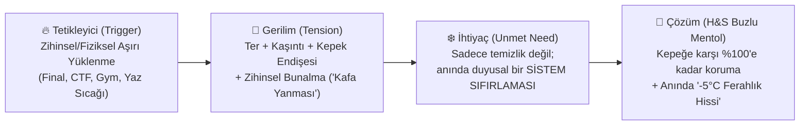

# 🎯 1. WHO: Tüketici Analizi, Personalar ve Derin İçgörü Mimarisi

> **P&G Brand Building Framework — Bölüm 1 (30 Puan)**  
> **Temel Odak:** 18–24 yaş Z Kuşağı gençlerin fiziksel ve zihinsel "hararet" anlarını yakalamak ve H&S Buzlu Mentol Ferahlığı'nı bu anların doğal "sistem sıfırlayıcısı (reset)" yapmak.

---

## 1.1. Makro Hedef Kitle Tanımı (Target Audience)

* **Demografi:** 18–24 yaş arası üniversite öğrencileri, yeni mezun genç profesyoneller, spor ve teknoloji topluluklarında aktif Z kuşağı bireyler.
* **Psikografi:**
  * Çoklu görev (multitasking) kültüründe yaşayan, yüksek tempo ve rekabet içinde sınırlarını zorlayan bireyler.
  * "Otantik" ve "deneyim odaklı" iletişim diline yanıt veren; geleneksel reklam vaatleri yerine akran onayına (peer-to-peer talkability) ve mizaha değer veren kitle.
  * Kişisel bakımda hem **fonksiyonel kesinlik** (kepeksiz, temiz saç derisi) hem de **anlık duyusal ödül** (ferahlık, uyanıklık, enerji yenilenmesi) arayan tüketiciler.

---

## 1.2. Üç Çekirdek Tüketici Personası (Core Personas)

| Kriter | 👨‍💻 Persona 1: "Zihinsel Maratoncu" (Coder / Vize-Final Sabahçısı) | 🏋️‍♂️ Persona 2: "Fiziksel Sınır Zorlayıcı" (Gym & Kampüs Sporcusu) | 🎧 Persona 3: "Sosyal Hiperaktif" (Festival & Kampüs Gezgini) |
| :--- | :--- | :--- | :--- |
| **Yaş & Profil** | 20 yaşında, Bilgisayar Müh. öğrencisi | 22 yaşında, İşletme öğrencisi & Amatör Crossfit/Fitness sporcusu | 19 yaşında, İletişim öğrencisi, öğrenci kulübü başkanı |
| **Tipik "Hararet" Anı** | Cumhurbaşkanlığı Millet Kütüphanesi'nde 14 saatlik final/kodlama maratonu veya 24 saatlik siber güvenlik CTF / Hackathon yarışması. | Ağır squat, deadlift veya bench press antrenmanı sonrası ya da halı saha maçı çıkışı. | Gün boyu kampüs etkinlikleri, toplu taşıma koşturmacası ve akşamki sosyal buluşma öncesi. |
| **Fiziksel & Duygusal Belirti** | Kafa derisinde ısınma, yağlanma, kaşıntı hissi, zihinsel bulanıklık ("beyin yanması"). | Yoğun terleme, saç derisinde yapışkanlık, kepek tetiklenmesi, bunalma. | Basık ve sönük saçlar, günün yorgunluğu, sosyal ortama girmeden önce "yenilenme" ihtiyacı. |
| **Kullandığı Doğal Argo** | *"Kafa yandı"*, *"Sistem error verdi"*, *"Reset lazım"* | *"Hararet tavan yaptı"*, *"Buhar oldum"* | *"Hararet yapma"*, *"Bi' kafayı soğutalım"* |
| **H&S Buzlu Mentol Rolü** | Zihni açan, uyuşukluğu kıran **"-5°C Soğuk Başlatma (Cold Boot)"** etkisi. | Antrenman sonrası yangıyı dindiren **"-5°C Acil Soğutma (Cool-Down)"** etkisi. | Sosyal ortama çıkmadan önce özgüven ve tazelik veren **"-5°C Ferahlık Şoku"**. |

---

## 1.3. Tüketici Gerilimi ve İçgörü Matematiği (Tension & Insight)

### Derin İçgörü (The Core Consumer Insight)
> *"Hayatımın temposu o kadar yüksek ki bazen beynimin ve bedenimin kelimenin tam anlamıyla 'hararet yaptığını' hissediyorum. Böyle anlarda sıradan bir duş beni sadece temizler; ama benim tekrar kendime gelmek için kafa derimden başlayan şok edici bir soğutma ve sıfırlama (reset) hissine ihtiyacım var."*

---

## 1.4. Neden Head & Shoulders Buzlu Mentol Ferahlığı? (Reason to Believe - RTB)

1. **Duyusal Farklılaşma (-5°C Ferahlık Hissi):** Mentol kristalleriyle zenginleştirilmiş formül, suyla temas ettiği anda saç derisindeki soğuk algılayıcı reseptörleri (TRPM8) uyararak **-5°C ferahlık hissi** yaratır *(Not: Bu gerçek bir sıcaklık düşüşü değil, duyusal bir ferahlık hissidir)*.
2. **Fonksiyonel Güvence (Kepeğe Karşı Kanıtlanmış Koruma):** Hararet ve terlemenin tetiklediği saç derisi irritasyonu ve kepek problemine karşı Head & Shoulders'ın klinik olarak kanıtlanmış korumasını sunar.
3. **Kültürel Uyum:** Gençlerin "hararet yapma / kafanı soğut" diline doğrudan fiziksel bir karşılık verir.
