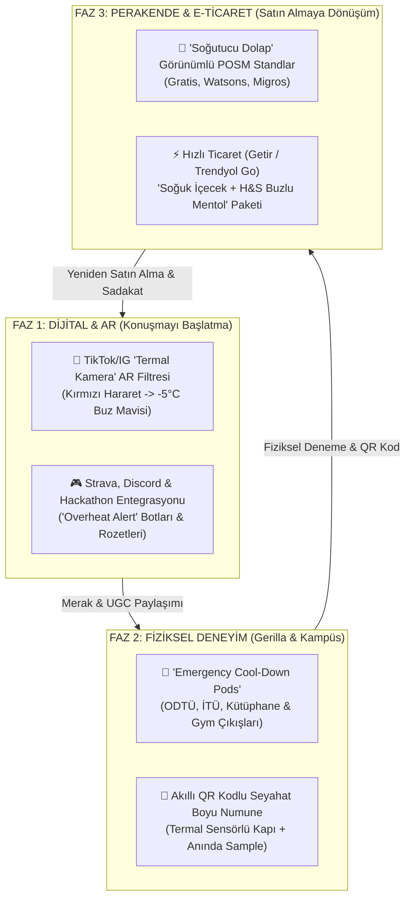

# 🚀 3. HOW: Konuşulabilir 360° Entegre Kampanya Mimarisi

> **P&G Brand Building Framework — Bölüm 3 (20 Puan)**  
> **Temel Odak:** Dijitalden kampüse, spor salonundan perakende rafına kadar tüm temas noktalarını (touchpoints) **"Harareti Kes, -5°C Hissine Geç!"** ana fikri etrafında tek bir omurgada birleştirmek.

---

## 3.1. 360° Ekosistem Akış Şeması

---

## 3.2. Faz 1: Dijital Etkileşim ve AR (Konuşmayı Başlatma)

### 1. TikTok & Instagram "Termal Hararet" AR Filtresi
* **Mekanizma:**
  * Kullanıcı ön kamerayı açtığında yüzü ve saçları **termal kamera (kızılötesi)** görünümündedir. Kafa bölgesinde yükselen kırmızı-turuncu ısı dalgaları ve sanal bir termometre (`HARARET: %99 🔥`) yer alır.
  * Kullanıcı **kafasını salladığında (Head Shake)** veya ekrandaki **"Harareti Kes"** butonuna bastığında, kafa derisinden başlayarak tüm ekrana buz kristalleri yayılır (gerçekçi *buz kırılma* ve *soğuk rüzgar* ASMR ses efektiyle).
  * Renk paleti anında **H&S Buz Mavisine** döner, saçlar pırıl pırıl görünür ve ekranda **`[-5°C FERAHLIK HİSSİ AKTİF ❄️]`** rozeti belirir.
* **Oyunlaştırma & Ödül:** Filtreyi `#HararetiKes` etiketiyle paylaşan kullanıcılar, kampüsteki fiziksel kabinlerden veya anlaşmalı e-ticaret platformlarından anında geçerli indirim/numune kodu kazanır.

### 2. Mikro-Topluluk Sızmaları (Community Seeding)
* **Hackathon, CTF ve Espor Turnuvaları:** 24-48 saat süren kodlama ve siber güvenlik yarışmalarının 16. saatinde ("Gece 03:00 Hararet Anı") katılımcılara **"Acil Soğutma Kiti (Emergency Overheat Kit)"** dağıtılır (İçeriği: H&S Buzlu Mentol, soğuk jel göz bandı ve QR kod).
* **Strava Koşu/Antrenman Entegrasyonu:** Belirli bir kalp ritmi/mesafe hedefini tamamlayan genç sporculara uygulama içi *"Harareti Kestin! Şimdi -5°C Hissine Geç"* dijital kuponu tanımlanır.

---

## 3.3. Faz 2: Gerilla Pazarlama ve Kampüs Aktivasyonları (Fiziksel Deneyim)

### "Acil Durum Ferahlama Kabinleri" (Emergency Cool-Down Pods)
* **Lokasyon Seçimi:**
  * **Üniversite Kampüsleri & Kütüphaneler:** ODTÜ Devrim/Çarşı, İTÜ Ayazağa, Boğaziçi Güney Meydan, Cumhurbaşkanlığı Millet Kütüphanesi ve merkezi öğrenci çalışma alanları (Özellikle vize/final haftaları).
  * **Büyük Spor Salonları & Festival Alanları:** MACFit vb. yoğun genç trafiği olan spor salonu çıkışları ve bahar şenlikleri.
* **Deneyim Tasarımı (Sensory Blueprint):**
  1. **Giriş (Termal Ekran):** Kabinin dışındaki ekran, yaklaşan öğrencinin silüetini kırmızı termal efekt ile gösterir: *"Hararet tespit edildi! Kabine gir."*
  2. **10 Saniyelik -5°C Ferahlık Hissi Deneyimi:** Kullanıcı kabine girdiğinde ve kırmızı **"HARARETİ KES"** butonuna bastığında; içeriden ferahlatıcı soğuk hava akımı, doğal mentol aroması, mavi LED ışık şovu ve buz kırılma ses efektleri yükselir.
  3. **Paylaşılabilir An (Photo/Video Booth):** Kabin içindeki kamera, kullanıcının saçları soğuk rüzgarla uçuşurken 5 saniyelik ağır çekim (slow-motion) TikTok/Reels videosunu çeker ve QR kod ile telefonuna aktarır.
  4. **Akıllı Numune Dağıtımı (Smart Sampling):** Deneyim sonunda otomat bölmesinden üzerinde benzersiz (unique) QR kod bulunan **H&S Buzlu Mentol Seyahat Boyu (90 ml)** numune verilir.

---

## 3.4. Faz 3: Perakende (Retail) ve Satın Almaya Yönlendirme (Conversion)

1. **Mağaza İçi "Soğutucu Dolap (Cooler Stand)" POSM Tasarımı:**
   * Kişisel bakım marketlerinde (Gratis, Watsons, Rossmann) ve zincir marketlerde H&S Buzlu Mentol Ferahlığı, standart şampuan rafından ayrılarak **içecek soğutucu dolabı** formunda tasarlanmış, buğulu cam efektli ve buz mavisi LED aydınlatmalı özel stantlarda sergilenir.
   * Standın kapağı açıldığında hafif bir soğuk rüzgar sesi ve *"Harareti Kes, -5°C Hissine Geç!"* görseli tüketiciyi karşılar.
2. **Hızlı Ticaret (Quick-Commerce) Çapraz Satış Kurgusu:**
   * Getir, Yemeksepeti Market ve Trendyol Go üzerinden gece geç saatlerde (vize/final çalışırken) enerji içeceği/soğuk kahve veya spor sonrası protein sütü sipariş eden kullanıcılara sepette **"Kafanı da Soğut: H&S Buzlu Mentol %25 İndirimli"** çapraz satış (cross-sell) önerisi sunulur.

---

## 3.5. 12 Haftalık Kampanya Yayılım Takvimi (Rollout Roadmap)

| Dönem | Faz | Odak Noktası | Ana Aksiyonlar |
| :--- | :--- | :--- | :--- |
| **Hafta 1–2** | **Teaser & Tohumlama** | Merak Uyandırma | Kampüs ve spor influencer'larının *"Kafam yandı, hararet tavan"* paylaşımları; AR filtresinin yayına alınması. |
| **Hafta 3–6** | **Lansman & Kampüs Baskını** | Vize/Final & Hackathon Dönemi | Üniversite kampüslerinde ve kütüphane çıkışlarında **Emergency Cool-Down Pod** kurulumları, 50.000+ QR kodlu numune dağıtımı. |
| **Hafta 7–10** | **Perakende & Gym Dalgası** | Denemeden Satın Almaya Geçiş | Spor salonu aktivasyonları, mağaza içi "Soğutucu Dolap" POSM stantlarının kurulumu, Hızlı Ticaret sepet entegrasyonları. |
| **Hafta 11–12** | **Retargeting & Sadakat** | Tekrar Satın Alma | QR kod okutan kullanıcılara özel yeniden hedefleme (retargeting) kampanyaları ve UGC kazananlarının duyurulması. |
