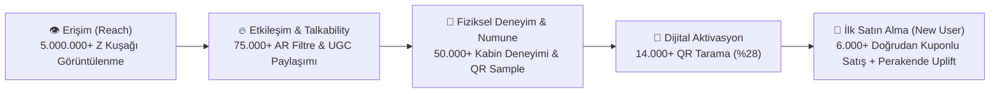

# 📊 4. SUCCESS: Başarı Ölçütleri (KPIs), Dönüşüm Hunisi ve Uyumluluk Matrisi

> **P&G Brand Building Framework — Bölüm 4 (5 Puan) + Uyumluluk Denetimi**  
> **Temel Odak:** Yaratılan organik konuşulabilirliği (Talkability) uçtan uca izlenebilir mühendislik ve pazarlama metrikleriyle ürün denemesine (Trial) ve satış hacmine (Sales Volume) bağlamak.

---

## 4.1. Kuzey Yıldızı Metrikleri ve KPI Matrisi

| Kategori | Metrik (KPI) | Ölçüm Yöntemi / Araç | Hedef Benchmark (12 Hafta) | İş Hedefi Bağlantısı |
| :--- | :--- | :--- | :--- | :--- |
| **1. Konuşulabilirlik (Talkability)** | **UGC (Kullanıcı İçeriği) Üretimi** | TikTok & IG `#HararetiKes` AR Filtresi kullanım ve paylaşım sayısı | **75.000+ Organik Video/Hikaye** | Markayı gençlerin kendi sosyal akışlarında birbirine önermesini sağlar. |
| **1. Konuşulabilirlik (Talkability)** | **Etkileşim Oranı (Engagement Rate)** | Beğeni, yorum, kaydetme ve arkadaşa gönderme (Share/DM) oranı | **>%6.5 ER** (Sektör ortalamasının 2.5x üstü) | "Hararet yapma" argosunun sahiplenilme hızını ölçer. |
| **1. Konuşulabilirlik (Talkability)** | **Share of Voice (SOV) & Sentiment** | Brandwatch / Sosyal medya dinleme araçları ile pozitif konuşulma payı | **+%40 Organik Mention Artışı** | Genç kitlede marka hatırlanırlığını (Top-of-Mind) büyütür. |
| **2. Deneme (Trial)** | **Kabin Deneyimi & Numune Dağıtımı** | Emergency Cool-Down Pod giriş sensörü ve dağıtılan numune adedi | **50.000+ Fiziksel Deneyim & Sample** | Ürünün "-5°C ferahlık hissi" vaadini fiziksel olarak kanıtlar. |
| **2. Deneme (Trial)** | **QR Kod Tarama Oranı (Scan-to-Visit)** | Numune şişeler üzerindeki dinamik UTM/QR kodların taranma oranı | **>%28 QR Tarama Oranı** | Fiziksel numuneden dijital ekosisteme geçişi ölçer. |
| **3. Satın Alma (Purchase)** | **Numuneden Satışa Dönüşüm (Sample-to-Purchase)** | QR kod içindeki tek kullanımlık indirim kuponlarının perakendede/e-ticarette kullanımı | **>%12 Kupon Kullanım (Redemption) Oranı** | İlk kez deneyen (New-to-Brand) kullanıcı kazanımını doğrular. |
| **3. Satın Alma (Purchase)** | **Perakende Satış Hacmi Artışı (Sales Uplift)** | "Soğutucu Dolap" POSM bulunan mağazalarda vs. kontrol mağazalarında satış artışı | **+%22 SKU Bazlı Hacim Artışı** | Yatırımın (ROI) doğrudan kârlı büyüme etkisini kanıtlar. |

---

## 4.2. Uçtan Uca Dönüşüm Hunisi (Attribution Funnel)

---

## 4.3. Mühendislik Yaklaşımıyla A/B Test ve Optimizasyon Mimarisi

1. **Lokasyon Bazlı QR & UTM İzleme:**
   * Dağıtılan her numune partisi lokasyona özel dinamik parametre taşır (Örn: `?utm_source=coolpod&utm_medium=qr&utm_campaign=minus5&utm_content=odtu_kutuphane` vs. `...&utm_content=macfit_kadikoy`).
   * Bu sayede **Zihinsel Hararet (Kütüphane/Kampüs)** ile **Fiziksel Hararet (Spor Salonu)** noktalarından hangisinin daha yüksek satın alma dönüşümü (LTV/CAC) getirdiği gerçek zamanlı ölçülür.
2. **Perakende POSM A/B Testi:**
   * 50 test mağazasında **"Soğutucu Dolap" görünümlü özel POSM standı** kullanılırken, benzer demografideki 50 kontrol mağazasında standart raf dizilimi korunarak net satış farkı (Incremental Lift) hesaplanır.

---

## 4.4. P&G DO's & DON'Ts Uyumluluk Denetimi (Compliance Checklist)

| Kriter | Durum | Kampanya Uygulaması |
| :--- | :---: | :--- |
| **Tüketici zorluğu (Challenge) üzerinde net uzlaşı sağlandı mı?** | ✅ **EVET** | Gençlerin yoğun ders/kodlama ve spor anlarındaki zihinsel/fiziksel "hararet" ve saç derisi bunalması merkeze alındı. |
| **Tek bir net ve akılda kalıcı slogan var mı?** | ✅ **EVET** | ***"Harareti Kes, -5°C Hissine Geç!"*** tüm mecralarda tek çatı slogan olarak kullanıldı. |
| **Aktivasyonlar kopuk (disconnected) değil, ana fikirle bütünleşik mi?** | ✅ **EVET** | Termal AR filtresi, Soğutma Kabini ve Soğutucu Dolap POSM standı aynı "Harareti Kes -> -5°C Hissine Geç" deneyimini yaşatır. |
| **Yeni/onaysız ürün iddiası uydurmaktan kaçınıldı mı? (No invented claims)** | ✅ **EVET** | **"-5°C" ifadesi hiçbir yerde tıbbi/fiziksel bir kafa derisi sıcaklığı düşüşü olarak sunulmadı; daima "-5°C Ferahlık Hissi" (sensory cooling sensation) olarak konumlandırıldı.** |
