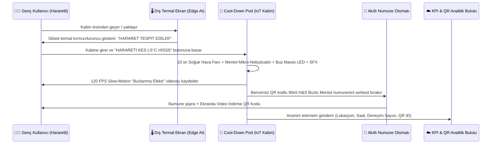

# 🛠️ 5. ENGINEERING BLUEPRINT: "Emergency Cool-Down Pod" & AR Teknik Mimarisi

> **Mühendislik & Deneyim Tasarımı Ek Dokümanı**  
> **Temel Odak:** Faz 1'deki *Termal AR Filtresi* ve Faz 2'deki *Acil Durum Ferahlama Kabinleri (Emergency Cool-Down Pods)* için donanım, sensör, IoT telemetri ve veri gizliliği (KVKK) mimarisi.

---

## 5.1. "Emergency Cool-Down Pod" Donanım ve Duyusal Akış Şeması

Kampüslere (ODTÜ, İTÜ, Millet Kütüphanesi çıkışları) ve spor salonlarına yerleştirilecek kabinler, 15 saniyede hem fiziksel ferahlama sağlayan hem de sosyal medya içeriği (UGC) ve izlenebilir numune üreten akıllı birer IoT istasyonudur.

---

## 5.2. Kabin İçi 4 Boyutlu Duyusal Sistem (4D Sensory Stack)

| Katman | Donanım Bileşeni | Tetiklenen Duyu | Tüketiciye Yaşattığı Deneyim |
| :--- | :--- | :--- | :--- |
| **1. Görsel (Visual)** | Dış cephede sahte termal (lut-mapped RGB) ekran + İç cephede adreslenebilir RGBW Buz Mavisi LED matrisi | Görme | Kırmızı/turuncu "Hararet" modundan parlak "Buz Mavisi (-5°C Hissi)" moduna sinematik geçiş. |
| **2. Dokunsal (Tactile)** | Yüksek debili yönlendirilmiş soğuk hava üfleyiciler (Vortex Air Jets) | Dokunma / Deri | Saç derisine ve enseye doğrudan temas eden anlık serin rüzgar şoku. |
| **3. Kokusal (Olfactory)** | Kuru soğuk buhar teknolojili **Mentol & Nane Mikro-Nebulizatörü** | Koklama | H&S Buzlu Mentol şişesi açıldığında alınan ikonik ferah kokunun kabin içinde solunması. |
| **4. İşitsel (Auditory)** | Yönlü (Directional) Stereo Hoparlör | İşitme | Butona basıldığı an duyulan derin *buz kristallenme (frost crack)* ve *soğuk rüzgar (sub-zero swoosh)* ASMR ses efekti. |

---

## 5.3. Akıllı Numune Otomatı ve Anti-Suistimal (Fair-Sampling) Mekanizması

Üniversite kampüslerinde ücretsiz numune dağıtımlarında en sık karşılaşılan sorun, aynı kişilerin birden fazla numune alarak stokları hızla tüketmesidir. **Project-Minus5** bunu mühendislik yaklaşımıyla çözer:

1. **QR Doğrulama ile Tekil Numune Dağıtımı:**
   * Kullanıcı kabin içindeki deneyimi tamamladığında ekranda dinamik bir QR kod belirir veya kullanıcı telefonundan `#HararetiKes` AR filtresini açıp okutur.
   * Otomat, cihaz parmak izi / tek kullanımlık oturum jetonu (session token) ile her öğrenciye **1 adet 90 ml seyahat boyu H&S Buzlu Mentol** verir.
2. **Dinamik UTM & Seri Numarası Eşleşmesi:**
   * Her numune kutusunun üzerindeki QR kod; `pod_id` (Örn: `ODTU_01`, `MILLETLIB_02`, `MACFIT_04`) ve `timestamp_bucket` bilgisiyle ilişkilendirilir.
   * Kullanıcı evde duş sonrası şişedeki QR kodu taradığında, açılan mikro sitede *"ODTÜ'de başlattığın -5°C ferahlık hissini devam ettir — İlk tam boy şişende %30 indirim!"* mesajıyla karşılaşır.

---

## 5.4. KVKK / GDPR ve Yasal Uyumluluk Mimarisi

* **Sıfır Biyometrik Kayıt (Privacy by Design):** Kabin dışındaki "Termal Kamera" ekranı hiçbir görüntüyü kaydetmez veya buluta göndermez; kamera akışı yerel (on-device) olarak gerçek zamanlı renk haritasına (Thermal False-Color LUT) dönüştürülür ve RAM üzerinde anlık işlenip silinir.
* **İsteğe Bağlı Video İndirme:** Kabin içinde çekilen 5 saniyelik ağır çekim (slow-motion) TikTok/Reels videosu yalnızca kullanıcı kendi telefonuyla ekrandaki geçici QR kodu okutursa indirilir; 60 saniye sonra yerel önbellekten otomatik olarak silinir.
* **Ürün İddiası Uyumluluğu (Claim Compliance):** Kabin ekranlarında, AR filtresinde ve numune şişelerinde **"-5°C Ferahlık Hissi"** ifadesi standart olarak yer alır; gerçek bir vücut/deri sıcaklığı düşürme iddiası (tıbbi/fiziksel iddia) kesinlikle kullanılmaz.
