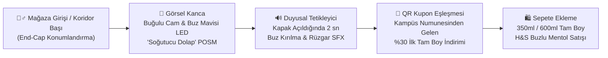

# 🛒 7. RETAIL & QUICK-COMMERCE PLAYBOOK: "Soğutucu Dolap" POSM ve Hızlı Ticaret Mimarisi

> **Faz 3 Perakende & Satışa Dönüşüm (Conversion) Rehberi**  
> **Temel Odak:** Dijitalde (`#HararetiKes` AR Filtresi) ve kampüste (*Emergency Cool-Down Pods*) yaratılan yüksek konuşulabilirliği, alışveriş anında (*First Moment of Truth - FMOT*) doğrudan ürün denemesine ve tam boy satın almaya dönüştürmek.

---

## 7.1. Perakende İçgörüsü: "Şampuan Reyonundaki Körlüğü Kırmak"

18–24 yaş Z kuşağı tüketicisi kişisel bakım marketlerine (Gratis, Watsons, Rossmann) veya zincir marketlere (Migros, CarrefourSA) girdiğinde şampuan reyonunda onlarca benzer mavi/beyaz şişeyle karşılaşır ve **raf körlüğü (*shelf blindness*)** yaşar.

**Project-Minus5 Çözümü:**  
Head & Shoulders Buzlu Mentol Ferahlığı'nı standart şampuan rafından çıkarıp, tüketicinin zihnindeki **"Soğuk İçecek / Acil Ferahlama"** kodlarıyla eşleşen **"Soğutucu Dolap (Cooler Stand)"** görünümlü özel POSM stantlarına taşıyoruz.

---

## 7.2. "Soğutucu Dolap (Cooler Stand)" POSM Teknik ve Görsel Spesifikasyonları

| Bileşen | Tasarım ve Mühendislik Detayı | Psikolojik & Satış Etkisi |
| :--- | :--- | :--- |
| **Gövde Formu** | İçecek soğutucusu (red bull / soğuk kahve dolabı) formunda, 175 cm x 65 cm x 55 cm ölçülerinde modüler end-cap ünitesi. | Şampuan kategorisinde daha önce görülmemiş bir form faktörü sunarak mağaza içinde **organik fotoğraf çekme (UGC)** noktası yaratır. |
| **Ön Kapak & Dokular** | Şeffaf akrilik kapak üzerinde **3D UV baskılı su damlacıkları (kondensasyon)** ve kenarlarda **buz kristali / kırağı (frost)** dokusu. | Ürüne dokunmadan önce bile beynin görsel korteksinde **"-5°C ferahlık hissi"** beklentisini tetikler *(Gerçek soğutma motoru içermez, enerji dostudur)*. |
| **Aydınlatma (LED)** | 6500K Soğuk Beyaz + `#00E5FF` Buz Mavisi iç LED şerit aydınlatma; üst alınlıkta parlayan ***"Harareti Kes, -5°C Hissine Geç!"*** neon-efektli başlık. | Standart sarı/beyaz mağaza ışıklarının arasında 15 metre mesafeden dikkat çeker. |
| **Mikro-Sensörlü Ses (SFX)** | Kapak açıldığında manyetik reed-switch sensörü ile tetiklenen 2 saniyelik hafif *soğuk rüzgar & buz kristallenme* ses efekti. | Alışveriş anını eğlenceli bir mikro-deneyime dönüştürür, akranlar arası konuşulabilirliği pekiştirir. |
| **Yasal Uyumluluk Etiketi** | Standın ön yüzünde okunaklı bilgi notu: *"*-5°C gerçek bir sıcaklık düşüşü değil, ürünün mentol formülüyle yarattığı ferahlık hissidir."* | P&G yasal ve klinik uyumluluk standartlarını (*No Invented Product Claims*) %100 korur. |

---

## 7.3. Hızlı Ticaret (Quick-Commerce) Algoritmik Çapraz Satış Kurgusu

Z kuşağı öğrencileri ve genç profesyoneller; vize/final sabahlamalarında, CTF/Hackathon gecelerinde veya antrenman sonrasında **Getir, Trendyol Go, Yemeksepeti Market ve Migros Hemen** uygulamalarını yoğun biçimde kullanmaktadır.

### Tetikleyici Sepet Kuralları (Smart Basket Triggers)

| Senaryo | Saat Aralığı | Sepetteki Tetikleyici Ürünler (Trigger SKUs) | Ödeme Öncesi Çıkan Akıllı Teklif (Pop-up / Cross-Sell Banner) |
| :--- | :---: | :--- | :--- |
| **1. Gece Kütüphane / Kodlama Mesaisi** | `21:00 – 04:00` | Soğuk Kahve (Cold Brew / Iced Latte), Enerji İçeceği, Atıştırmalık, Hazır Noodle | **🔥 Kafa Yandı mı? Harareti Kes!** *"Gece mesaisinde zihnini sıfırla: H&S Buzlu Mentol Ferahlığı sepetine özel **%25 İndirimli**!"* |
| **2. Antrenman & Spor Sonrası** | `17:00 – 22:00` | Protein Sütü, Protein Bar, İzotonik Sporcu İçeceği, Muz / Yulaf | **🏋️ Set Bitti Ama Yangın Bitmedi mi?** *"Antrenman hararetini -5°C ferahlık hissiyle kes: H&S Buzlu Mentol'ü sepete ekle!"* |
| **3. Yaz Sıcağı & Gündüz Bunalması** | `11:00 – 17:00` | Soğuk Su, Gazlı İçecek, Dondurma, Soğuk Çay | **🧊 Sıcaklara Karşı Acil Soğutma Butonu!** *"Harareti Kes, -5°C Hissine Geç — H&S Buzlu Mentol şimdi indirimde."* |

---

## 7.4. Numuneden Tam Boya (Sample-to-Full-Size) Kapalı Devre Köprü

Faz 2'de üniversite kampüslerindeki ve spor salonlarındaki *Emergency Cool-Down Pod* kabinlerinden dağıtılan **50.000 adet 90 ml seyahat boyu numune**, tek seferlik bir hediye değil, ölçülebilir bir **yeni müşteri kazanım hunisidir (acquisition funnel)**:

1. **Deneyim (Gün 1–3):** Öğrenci aldığı 90 ml numuneyi yurtta veya evde ilk duşunda dener; mentol formülünün yarattığı **-5°C ferahlık hissini** ve kepeksiz temizliği bizzat yaşar.
2. **QR Tarama (Gün 4–7):** Şişenin arkasındaki *"Ferahlığı Devam Ettir — %30 İndirim Kodunu Al"* çağrılı dinamik QR kodu okutur.
3. **Satın Alma (Gün 7–14):** Açılan sayfada tek tıkla **Gratis / Watsons / Migros kasa barkodu** veya **Trendyol / Hepsiburada / Getir kupon kodu** üretilir. Böylece fiziksel saha aktivasyonu doğrudan tam boy (350 ml / 600 ml) satışa bağlanır.
