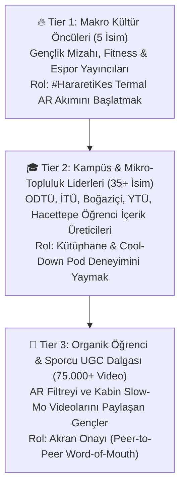

# 📣 9. INFLUENCER & CREATOR PLAYBOOK: Topluluk Tohumlama ve İçerik Üretici Brief Rehberi

> **Faz 1 Organik Konuşulabilirlik (Talkability) & UGC Üretim Rehberi**  
> **Temel Odak:** 18–24 yaş Z kuşağının "reklam kokan" içerikleri kaydırıp geçme (*ad-skipping*) refleksini aşmak için; kampüs mizahı, spor/fitness ve yazılım/CTF/gaming topluluklarına kendi doğal dilleriyle sızmak.

---

## 9.1. Üç Katmanlı Tohumlama Piramidi (3-Tier Seeding Pyramid)

---

## 9.2. Persona Bazlı Hazır İçerik Üretici Briefleri (Creator Briefs)

### 🎬 Brief 1: Kampüs, Vize/Final & Yazılım İçerik Üreticileri
* **Hedef Kitle Personası:** *Zihinsel Maratoncu (Üniversiteli / CTF & Hackathon Yarışmacısı)*
* **Kanca (İlk 2 Saniye - Scroll-Stopper):** Gece saat 02:30'da kütüphanede veya bilgisayar başında `#HararetiKes` **Termal Kamera AR Filtresi** açıkken başla; kafan kıpkırmızı parlasın.
* **Doğal Söylem (Script):**
  > *"Arkadaşlar vize haftasında / CTF yarışmasında 14. saat... Termal kamerada bile beynimin alev aldığı tescillendi! Şimdi harareti kesip -5°C hissine geçiyoruz."*
* **Geçiş Aksiyonu (Transition):** Kafanı salla (*Head Shake*), ekran buz mavisine (`[-5°C Ferahlık Hissi Aktif ❄️]`) dönsün ve masadaki/duştaki **H&S Buzlu Mentol Ferahlığı** şişesini göster.
* **Zorunlu Uyumluluk Notu (DO's & DON'Ts):** Videoda veya açıklamada kesinlikle "kafa sıcaklığını 5 derece düşürür" deme; daima **"-5°C ferahlık hissi"** ifadesini kullan.

---

### 🏋️ Brief 2: Gym, Fitness & CrossFit İçerik Üreticileri
* **Hedef Kitle Personası:** *Fiziksel Sınır Zorlayıcı (Gym & Kampüs Sporcusu)*
* **Kanca (İlk 2 Saniye):** Ağır *squat* veya *bench press* setinin son tekrarından hemen sonra nefes nefese Termal AR filtresini aç.
* **Doğal Söylem (Script):**
  > *"Set bitti ama hararet bitmedi! Antrenman sonrası o yanma ve saç derisi bunalmasını tek bir şey kesiyor: Harareti Kes, -5°C Hissine Geç!"*
* **Fiziksel Pod Bağlantısı:** Spor salonu çıkışındaki **Emergency Cool-Down Pod** kabinine gir, kırmızı butona basıp 10 saniyelik soğuk hava + mentol buharı şokunu ve aldığın 90 ml QR kodlu numuneyi göster.

---

## 9.3. "H&S Emergency Overheat Kit" (PR & Hackathon Seeding Kutusu)

Yalnızca influencer'lara değil; üniversitelerin **24 saatlik Hackathon, Siber Güvenlik CTF yarışmaları ve Espor turnuvalarının** gece 02:00 ("Sistem Hararet Saati") diliminde yarışmacı masalarına sürpriz olarak bırakılan özel tasarım kit:

| Kutu Bileşeni | Tasarım Detayı | Paylaşım (Talkability) Tetikleyicisi |
| :--- | :--- | :--- |
| **1. Dış Kutu Tasarımı** | Üzerinde termokromik (dokununca el ısısıyla kırmızıdan buz mavisine dönen) mürekkep baskılı **"ACİL DURUM SOĞUTMA KİTİ"** kutusu. | Kutu daha açılmadan renk değiştirdiği için %90+ Instagram Story / TikTok paylaşım oranı üretir. |
| **2. Ürün & Deneyim** | 1x Tam Boy H&S Buzlu Mentol Ferahlığı (350ml) + 2x Arkadaşa Hediye Edilebilir 90ml QR Numune. | *"Kendin ferahla, hararet yapan sıra arkadaşını da kurtar"* mekanizmasıyla ikincil deneme (secondary trial) yaratır. |
| **3. Dijital Etkileşim Kartı** | `#HararetiKes` Termal AR Filtresi doğrudan açılış QR kodu ve özel Discord/Strava rol rozeti kodu. | Fiziksel kutuyu dijital UGC hunisine bağlar. |
