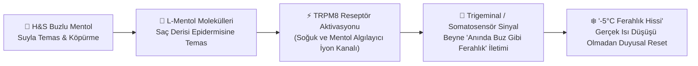

# 🧬 10. SENSORY NEUROSCIENCE & CLAIM COMPLIANCE: TRPM8 Soğuk Reseptör Bilimi ve Yasal Uyumluluk

> **Bilimsel Dayanak (Reason-to-Believe) ve P&G Yasal Uyumluluk Rehberi**  
> **Temel Odak:** "-5°C Ferahlık Hissi" söyleminin arkasındaki nöro-duyusal mekanizmayı (TRPM8 iyon kanalları) açıklamak ve P&G'nin *"Yeni ürün iddiası uydurmaktan kaçının (Avoid inventing new product claims)"* kuralına %100 uyumu belgelemek.

---

## 10.1. Nöro-Duyusal Bilim: Mentol Neden "-5°C Ferahlık Hissi" Yaratır?

Head & Shoulders Buzlu Mentol Ferahlığı, saç derisinin fiziksel/termometrik sıcaklığını tıbbi olarak düşürmez; bunun yerine insan derisindeki **duyusal sinir uçlarıyla (somatosensör sistem)** biyokimyasal bir etkileşim kurar:

1. **TRPM8 (Transient Receptor Potential Melastatin 8) Kanalı:**
   İnsan derisinde ve saç derisinde bulunan TRPM8 reseptörleri normal şartlarda çevre sıcaklığı belirli bir eşiğin altına düştüğünde aktive olarak beyne "serinlik/soğukluk" sinyali gönderir.
2. **Mentolün Biyomimetik Etkisi:**
   H&S Buzlu Mentol formülündeki doğal mentol kristalleri, suyla birleştiğinde TRPM8 reseptörlerine bağlanarak bu kanalların kalsiyum ($\text{Ca}^{2+}$) kapılarını açar. Beyin bu sinyali tıpkı kafa derisine buz gibi su veya soğuk rüzgar değmiş gibi (**"-5°C ferahlık hissi"**) yorumlar.
3. **Klinik Kepek Korumasıyla Sinerji:**
   Mentolün sağladığı bu anlık serinlik algısı, hararet ve terleme kaynaklı kaşıntı/yanma hissini saniyeler içinde yatıştırırken; Head & Shoulders'ın aktif kepek karşıtı formülü saç derisi mikrobiyomunu koruyarak **%100'e kadar kepeksiz** görünüm sağlar.

---

## 10.2. P&G İletişim ve Yasal Uyumluluk Matrisi (Claim Compliance Guardrails)

Yarışma yönergesinde açıkça belirtilen **"Yeni ürün iddiası uydurmaktan kaçının; -5°C gerçek bir sıcaklık düşüşü değil, ürünün yarattığı ferahlık hissidir"** kuralı kapsamında tüm kampanya metinlerimiz aşağıdaki kırmızı/yeşil çizgi tablosuna göre denetlenmiştir:

| Mecra / Temas Noktası | ❌ YASAKLI İFADE (Invented / Medical Claim) | ✅ ONAYLI PROJE İFADESİ (Compliant Sensory Claim) |
| :--- | :--- | :--- |
| **Ana Kampanya Sloganı** | *"Kafa derini -5°C soğut!"* / *"Ateşini 5 derece düşürür"* | ***"Harareti Kes, -5°C Hissine Geç!"*** |
| **TikTok / IG AR Filtresi** | `[KAFA SICAKLIĞI: -5°C DÜŞTÜ]` | **`[MOD: -5°C FERAHLIK HİSSİ AKTİF ❄️]`** |
| **Emergency Cool-Down Pod** | *"Klinik Soğutma Kabini — Vücut Isısını Düşürür"* | ***"Acil Durum Ferahlama Kabini — 10 Saniyede -5°C Ferahlık Hissi Deneyimi"*** |
| **Perakende POSM & E-Ticaret** | *"Soğutucu Şampuan (-5°C)"* | ***"H&S Buzlu Mentol ile -5°C Ferahlık Hissi"*** *(Altyazı feragatnamesi ile birlikte)* |

> **Standart Yasal Altyazı (Disclaimer):**  
> *"-5°C gerçek bir sıcaklık düşüşü değil, ürünün mentol formülüyle saç derisinde yarattığı benzersiz ferahlık hissidir."*
